# 02 · 语音录入版轻量进销存 · 系统架构设计与任务分解

> 文档版本：**v1.1** ｜ 作者：高见远（Gao）· 架构师 ｜ 阶段：部分工作流第二阶段（仅设计与任务分解，不含实现代码）
> 需求基线：`docs/01-PRD.md`（许清楚 · 产品经理，973 行，唯一基线）＋ `docs/00-决策速览.md` §4/§5（平台规则已核实）。本文所有设计均回溯到 PRD 章节号。
> 配套图文件：`docs/class-diagram.mermaid`（类图）、`docs/sequence-diagram.mermaid`（核心调用时序）。
> 项目代号：`voice_inventory_lite`。
> **v1.1 基线**：用户 2026-11-15 拍板的《定稿决策卡》（后端微信云托管 / 小程序虚拟支付 / 电脑版微信大屏 / 小程序备案 / 取消自动续费 / 不做独立网页版）为本版唯一基线；与 v1.0 冲突处以本版为准。

**修订记录**

| 版本 | 日期 | 修订人 | 变更摘要 |
|---|---|---|---|
| v1.0 | 2026-11-15 | 高见远 | 初版：云函数后端 + PostgreSQL RLS + 独立网页管理端 + 包月订阅；10 条关键设计决策 D1~D10 |
| **v1.1** | 2026-11-15 | 高见远 | **定点增量修订**：① 端侧改为「同一小程序 + 电脑版微信大屏」，删独立网页管理端工程；② 后端改「微信云托管 `callContainer` 私有协议」（免域名/免 ICP 备案/免 HTTPS 证书/免配服务器域名）；③ 音频改「对象存储临时直传 + 仅传引用」（`wx.cloud.uploadFile` 不需配合法域名，音频本体不进 `callContainer` 请求体）；④ 收款改「小程序虚拟支付 + 发货推送 + 一次性 30 天权益/加油包」，取消自动续费；⑤ 新增权益/订单/道具/发货事件数据模型与 6 个 API、§5.4 发货时序；⑥ 多租户补「云托管下数据层落地方案 A/B/C」与 RLS 降级说明；⑦ 新增 D11~D16 决策、Q19~Q24 待核实、H19~H23 硬约束；⑧ T01~T05 任务表与里程碑更新（小程序备案 T01 并行启动）。**未受影响章节原样保留，原 10 条关键设计决策除被本卡明确推翻者外全部保留** |

## 0. 数据真实性声明与文档约定

| 项 | 约定 |
|---|---|
| 数据真实性 | 本文**不引用任何真实竞品名称与价格**；不点名具体 ASR / LLM / 云厂商的型号与报价，一律以「ASR 服务 / LLM 服务 / 微信云托管 / 云开发云函数」泛称并标注 **需核实**；**平台规则（虚拟支付准入、费率、备案时长、`callContainer` 限制、消息推送事件覆盖等）为 2026-11-15 检索结论，平台规则会变，上线前须逐条复核**（见 `docs/00-决策速览.md` §4/§5） |
| 参数性质 | 所有时长、阈值、额度、token 数、成本、延迟、命中率均为 **「假设，需核实 / 需压测校准」**，沿用 PRD 5.2 / 6.1 / 8.3 的建议值，不得写成事实 |
| 表达形式 | 表格 + Mermaid 图优先，避免大段叙述 |
| 标注体系 | `【PRD x.y】`= 需求出处；`【决策 Dx】`= 关键设计决策；`【需核实】`= 外部能力/报价/合规；`【假设】`= 待校准参数 |

## 0.1 PRD 硬约束 → 架构约束映射（下游不得违背）

| # | PRD 硬约束 | 出处 | 架构落地位置 |
|---|---|---|---|
| H1 | ASR 文本 → 意图+槽位 → **回显确认卡片 → 人确认 → 落账**；写操作绝不静默 | 2.1 / 3.1 | §2.3⑥、§5.2；`ConfirmCard` 为写操作唯一入口 |
| H2 | 只读查询不占确认卡片、不写库 | 3.1 / 2.8 R0 | §5.1 `readOnly` 分支、§2.3② |
| H3 | 解析 = 端侧过滤 → **规则/模板层优先（不调 LLM）→ LLM 兜底** 双通道 | 5.3 / 5.4 / 附2 | §2.1 分层漏斗、§2.3③④ |
| H4 | LLM 输出紧凑 JSON + `source`（asr/default/computed/alias/pending）+ `confidence` + `clarify` | 2.9 / 附2 | §2.3④、附录 A2 JSON Schema |
| H5 | intent schema 38 个 / 12 域 / R0~R3 / C0~C3；18 个 `template_hit=true` | 2.8 / 2.9 | §6 `IntentRegistry`、附录 A3 |
| H6 | 18 槽位字典 + 缺省规则；缺省/换算/词表命中必须标来源 | 2.2 / 2.3 | §2.3⑥ `SlotFiller` + `source` 枚举 |
| H7 | 12 类歧义冲突；盘点快照 vs 增量入库最危险；换算系数不得臆造 | 2.6 | §2.3③ `ConflictDetector`、§3.2 |
| H8 | R3 白名单语音只生成待办，最终执行落 PC | 2.7 | §5.1 `PendingTask`、§5.3 状态机 |
| H9 | 撤销 = **反做单**（不删原单）；全写操作留痕；10 分钟窗口；被引用禁撤 | 3.8 | §4.3 `reversal`/`audit_log`、§7 |
| H10 | 确认卡片 7 区块；30s 超时**不落账**入待确认；C2 有按钮兜底、禁止超时自动执行 | 3.2 / 3.5 / 3.6 | §2.3⑥、§5.3 |
| H11 | 成本护栏参数（15s/0.8s/VAD 700~900ms/300ms/2 轮/60s 去重/60s 连续态） | 5.2 | §2.3①、§2.4 |
| H12 | Prompt 注入预算：Top20 + 个人词表 + 最近 3 条上下文，**不注入全量商品档案**；静态意图不调 LLM | 5.2 / 2.4 | §2.3④、§2.4 |
| H13 | 计费 = **成功生成确认卡片的录音**；失败/无意图/误触/取消不扣次；幂等；租户级配额 30/min、1000/day | 5.5 / 5.7 | §4.4 `usage_ledger`、§2.4 限流 |
| H14 | 超额**降级而非断服**（留规则层 + 数字键盘手动补录，锁 LLM 语义，历史可查可导出） | 5.6 | §2.4 模型降级策略 |
| H15 | ASR 置信度分级（≥0.85 / 0.6~0.85 / <0.6）、归一表、别名本 Top20、`sys.teach` 即时生效、三层词表回流、一次只问 1 槽给 2~3 选项 | 4.2 / 4.3 / 3.9 | §3 全章 |
| H16 | 多租户：Tenant→Store→Member→Role；商品/客户供应商租户级共享，库存/单据/盘点/损耗门店级，个人词表员工级；升级不迁移不改历史单号 | 7.2 / 7.3 | §4 全章 |
| H17 | 数据模型从第一天租户隔离，**UI 只暴露单商户** | 7.1 | §4.1 结论 |
| H18 | 毛利杠杆 = 规则层命中率 ≥45%；单条命令综合成本 ≤¥0.02 | 6.4 / 8.3 | §2.4 成本公式与降本 |
| **H19** | **后端改微信云托管（`callContainer` 私有协议）**：免自有域名 / 免 ICP 域名备案 / 免 HTTPS 证书 / 免配服务器域名，可关公网访问；**容器不内部署有状态服务、不持久化**；请求体**文本上限 100KiB（硬限制）**，二进制另有 20MiB 口径、超时 15s 与 60s 两处官方口径**并存需核实** | 决策卡 A4/A5 · 速览 §4 | §1.1 L2/L5、§1.3 D1/D11、§4.5 |
| **H20** | **收款走小程序虚拟支付**（`wx.requestVirtualPayment`，《运营规范》2.5.13）：不得用普通商户号 `wx.requestPayment`、不得引导外部付款；开二级商户号，道具「30 天权益」「语音加油包」；**发货只以「发货推送」为准**，前端 success 不作发货依据，`query_order` 查单兜底 + 幂等 | 决策卡 A7/A10 · 速览 §5 | §1.3 D12/D13、§5.1/§5.4、§6 类图 |
| **H21** | **电脑端 = 电脑版微信里跑同一个小程序**（`app.json` 配 `resizable` + 双栏适配）；原 PC 管理端职责由「小程序大屏管理页」承接（档案 / 说法训练 / 单据更正 / 报表 / 用量套餐 / 权限 / R3 待办审批 / 导出）；导出文件经微信文件传输助手 / 保存到微信 / 微信内预览，**不能网页下载** | 决策卡 A1/A3 · 速览 §4 | §1.1 L1、§1.2 框架表、§1.3 D14、§8.2/§8.3 |
| **H22** | **小程序备案（AppID 备案，与域名无关）为上线与开支付前提**：平台初审 1-2 工作日 + 短信核验 24h + 管局 1-20 工作日，不收费不加急，**T01 并行启动** | 决策卡 A6 · 速览 §5.5 | §1.3 D16、§8.3 T01、§9 Q24 |
| **H23** | **不做独立网页版 / 不做 H5、不引入独立前端框架工程；不做账号密码**；同一入口同一 AppID，微信身份 openid/unionid → `tenant_id`；隔离靠登录态 + `tenant_id` + 隔离机制，**绝不「一客户一域名」** | 决策卡 A1/A2 · 速览 §4 | §1.2、§1.3 D15、§8.1/§8.2、§9 |

---

# Part A · System Design

## 1. 架构总览（Implementation Approach）

### 1.1 分层架构图

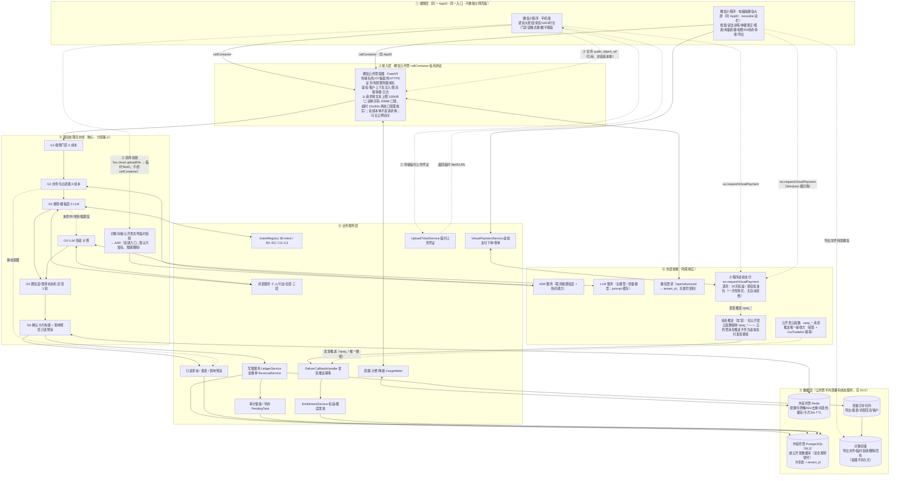

### 1.2 核心技术难点与框架选型

| 难点 | 说明 | 选型 / 手法 | 理由 |
|---|---|---|---|
| D1 语音输入不可靠但账目不可错 | ASR 口音、同音词、吞字 | 「结构化回显 + 人确认 + 只读影响预演 + 反做单」四重兜底，而非追求 100% 识别率 | 【PRD 4.4】把纠错成本转为「越用越准」资产 |
| D2 AI 成本必须可控 | 无效调用是最大浪费源 | 六层漏斗 + 规则层优先 + prompt 缓存 + 注入预算 + 配额熔断 | 【PRD 5.1 / 6.4】规则层命中率是毛利杠杆 |
| D3 歧义判定要可解释 | 盘点快照 vs 增量入库 判错即账错 | 规则层用**确定性关键词 + 冲突检测器**，不用概率模型拍板；判不出强制澄清 | 【PRD 2.6 #1】可审计、可回归测试 |
| D4 「影响预览」绝不能写库 | 展示「8 箱→10 箱」若真写库即事故 | 纯函数 `simulate(state, delta)` + **只读库连接** + 落账前 CAS 版本校验 | 见 §6 `ImpactPreviewService` |
| D5 多租户漏加条件即串账 | 账目类串数据 = 信任崩塌 | RLS（DB 强制）+ ORM 全局 scope（应用）双保险 + CI 静态扫描 + 跨租户越权单测 | §4.2 |
| D6 端侧弱网/单手/嘈杂 | 档口环境 | 小程序原生录音 + VAD 端侧判停 + 卡片本地可编辑（编辑不重调 AI） + 数字键盘全降级路径 | 【PRD 3.7 / 4.4】 |
| D7 计费口径与信任 | 「废话不收钱」 | 仅 `ConfirmCard` 生成成功写 `usage_ledger`，`voice_session_id` 唯一约束幂等 | §4.4 |
| **D8（v1.1）音频本体不进 `callContainer`** | 云托管 `callContainer` 请求体**文本上限 100KiB 为硬限制**（二进制另有 20MiB 口径、超时 15s/60s 两处官方口径**并存需核实**），叠加容器不持久化 → **音频本体不作为请求体内容传输** | **对象存储 / 云开发文件临时上传 → 服务端仅传 `audio_object_ref` 引用**（方案 A，见 §2.3① 后「音频上传链路重设计」）；容器不持久化、临时对象限期删除 | 【决策卡 A5·已核实】**采用 `wx.cloud.uploadFile` / `wx.cloud.*` 直传，不需配服务器合法域名**（不引回域名/ICP 备案）；`wx.uploadFile` 才需配，**本设计禁用**；端侧 VAD/门禁不变 |
| **D9（v1.1）大屏导出路径** | 导出文件不能网页下载（无独立网页版），且电脑版微信大屏需单独适配 | 生成后**转发到微信文件传输助手 / 保存到微信 / 微信内预览**（API 需核实）；`app.json` 配 `resizable` + 双栏管理页 | 【决策卡 A1/A3】PC 端 API 差异、Mac 基础库限制、电脑端麦克风可用性均需核实（§9 Q23） |
| **D10（v1.1）发货事件单路径（已核实）** | 虚拟支付发货事件的接收路径是哪一条 | **唯一路径 = 云开发云函数消息推送**（云开发控制台 → 设置 → 其他设置 → 消息推送 → 推送模式「云函数」），接收 `xpay_goods_deliver_notify` / `xpay_refund_notify` / `xpay_complaint_notify` / `xpay_subscribe_*`（含 `xpay_subscribe_ios_refund_query_notify`）；**云托管消息推送不作为虚拟支付发货路径，不存在第二路径**；验签 + `deliver_event UNIQUE(tenant_id, out_trade_no)` 幂等；`OutTradeNo` 为幂等键、`Env`（0 现网 / 1 沙箱）区分环境；**不自建 `notify_url` 域名** | 【决策卡 A10·已核实】发货只以推送为准、前端 success 不作发货依据；`query_order` 查单兜底 |

**框架与库选型（默认栈，均可在 T01 调整）**

| 层 | 选型 | 理由 |
|---|---|---|
| 小程序（手机端） | 微信小程序原生 + TypeScript（`miniprogram/`） | 【决策卡 A1】同一 AppID、同一入口；原生避免跨端框架包体积与录音 API 兼容风险 |
| **电脑端（大屏管理页）** | **电脑版微信里跑同一个小程序**：`app.json` 配 `resizable` + 双栏适配 + 管理页组件（档案/说法训练/单据更正/报表/用量套餐/权限/R3 待办审批/导出）；**不做独立网页版 / 不做 H5 / 不引入独立前端框架工程**（H23） | 【决策卡 A1/A3】同一 AppID 同一 JWT；导出经微信文件转发/保存/预览（API 需核实）；大屏单独适配，Mac 基础库限制需核实 |
| 服务端 | **微信云托管容器**（`callContainer` 私有协议）：Python 3.11 + FastAPI + SQLAlchemy 2 + Pydantic v2 + Alembic | 【决策卡 A4】免域名/免 ICP 域名备案/免 HTTPS 证书/免配服务器域名、可关公网访问；Pydantic 承载 LLM 输出 JSON Schema 强校验；容器不持久化、不内部署有状态服务（A5） |
| 规则层 | 纯 Python：`re2`/`re` + AC 自动机（pyahocorasick）+ 中文数字解析自建 + Trie | 零外部费用、确定性、可解释、可单测；不引入小模型做主判 |
| 缓存/限流 | **外挂托管 Redis**（令牌桶 Lua 原子脚本 + TTL 卡片 + 60s 去重 + 词表热缓存）；**托管能力/延迟/成本需核实** | 【PRD 5.7】租户级配额需原子扣减；【决策卡 A5】云托管内不部署有状态服务 |
| 数据库 | **方案 A** 外挂托管 PostgreSQL（RLS / JSONB / 事务 / 部分索引，**推荐**）或 **方案 B** 云开发数据库（安全规则替代 RLS）；**外挂访问延迟/成本/隔离强度需核实**，见 §4.5 | RLS 是「防漏加 tenant_id」的最后防线（方案 A）；方案 B 无 RLS 时隔离强度下降，须补应用层替代（§4.5 / D7） |
| 异步 | **云托管服务 + 云开发云函数（xpay_* 消息推送接收）+ 轻量任务队列**（导出/报表/回流/销户） | 低频长任务不占实时解析链路；发货推送由云函数接收（A10） |
| **收款（v1.1 新增）** | **小程序虚拟支付 `wx.requestVirtualPayment` + 二级商户号 + 道具「30 天权益」「语音加油包」 + 发货推送 + `query_order` 查单兜底**；**不用 `wx.requestPayment`、不引导外部付款、取消自动续费**（A7/A8/A11/A12） | 【决策卡】虚拟商品/付费功能强制走虚拟支付（《运营规范》2.5.13）；一次性购买，到期提醒靠自有推送；iOS 需单独开通 IAP、微信 ≥8.0.68、最低支付 1 元；企业主体费率与 Windows 端口径需核实 |
| 可观测 | 结构化日志 + 指标（命中率/成本/配额）+ 告警 | §2.4 成本监控 |

**架构模式**：分层 + 管道-过滤器（语音流水线）+ 领域服务（写账）+ CQRS 轻量化（读写分离到只读连接，用于影响预演与报表）。MVP 保持**模块化单体**，不做微服务拆分；后端落在**微信云托管单服务容器**（1 自定义域名 = 1 服务，当前不绑自定义域名），云开发云函数仅作 `xpay_*` 消息推送接收。

### 1.3 关键设计决策清单

> 决策编号 **D1~D16**（v1.1 由 D1~D10 扩充），供下游实现与评审引用。**D1 / D7 / D10 为 v1.1 修订行，D11~D16 为 v1.1 新增行；D2~D6、D8、D9 原样保留**（决策卡 A12：原 10 条关键设计决策除被本卡明确推翻者外全部保留）。

| ID | 决策点 | 结论 | 备选方案 | 理由 | 代价 / 风险 |
|---|---|---|---|---|---|
| **D1（v1.1 重写）** | 后端形态：云函数 / 常驻自建 / **微信云托管** | **采用微信云托管容器**（小程序经 `callContainer` 私有协议调用，Python 3.11 + FastAPI 模块化单体）；解析流水线代码仍按「可无状态打包」组织 | (a) 云开发云函数；(b) 常驻自建服务 + 自有域名 | 【决策卡 A4】**免自有域名、免 ICP 域名备案、免 HTTPS 证书、免配服务器域名、可关公网访问**；私有链路不暴露公网；与「只服务小程序」的形态一致 | 【决策卡 A5】① 容器**不内部署有状态服务**（PG/Redis 外挂托管或改云开发数据库，见 §4.5）；② 容器**不持久化**（文件走对象存储）；③ `callContainer` **请求体文本上限 100KiB**（二进制另有 20MiB 口径、超时 15s/60s 两处口径待实测）→ **音频本体不进请求体**（见 D11）；④ **默认公网域名仅供接口测试、不能用于生产**；⑤ **1 自定义域名 = 1 服务**；⑥ 容器冷启动与最低实例成本**需核实**（§9 Q12）；⑦ **`xpay_*` 发货事件只走云开发云函数消息推送，云托管消息推送不作为该路径（已核实；D13 / Q20）** |
| **D2** | 同步 vs 异步解析 | **解析链路同步短请求**（同步返回卡片，目标 ≤2~3s【假设需核实】）；**录音直传、落账后审计/回流、导出/报表/销户走异步队列** | 全异步（轮询卡片） | 用户按完即等卡片，异步轮询增加交互步数与小程序轮询耗电；同步链路更短 | 同步链路必须设全链路超时（建议 3s 解析 / 8s 端到端【假设需核实】）与快速失败降级到「规则层/手动补录」 |
| **D3** | ASR 选型维度 | **必选维度**：① 中文方言/口音鲁棒（**需核实**）② **返回词级或句级 confidence** ③ **支持热词/自定义词表**（用于注入个人别名本）④ 一句话识别（非流式亦可）⑤ 按秒/按次计费可估 ⑥ 音频合规与留存策略（**需核实**）；**不把厂商型号写死**，用适配器 `AsrProvider` 隔离 | 流式 ASR；端侧 ASR | 词级置信度是 §3 分级澄清的前提；热词能把「快乐水」在 ASR 阶段就纠正，比后置纠错更省一次解析；适配器便于换供应商 | 热词条数上限、更新时间、置信度口径都 **需核实**；若供应商不返回 confidence，则启用 §3.1 代理置信度 |
| **D4** | LLM 主模型 / 小模型 / 端侧小模型 | **主模型**：中等能力、JSON 结构化输出稳定的通用模型（**需核实**）；**轻量模型**：仅用于「闲聊/无意图二分类」「二次确认词判别」等确定性小任务，且默认先用规则，规则不足才启用；**端侧小模型 MVP 不做**，P2 仅评估用于 VAD/唤醒词 | 全用大模型；全用小模型；端侧推理 | 歧义消解/多商品拆分需要语义能力；高频标准句式交给规则层（H3）；小程序包体积与算力不支持端侧模型，且端侧模型会把成本从「按次」变成「每端分发 + 维护」 | 双模型增加一次适配与评测成本；轻量模型误判「无意图」会漏记账，故必须有「低置信→不拦截→升级规则/LLM」的保守策略 |
| **D5** | 非命令过滤器实现 | **规则为主（0 成本）**：静音/能量/有效汉字/业务关键词白名单/领域动词表 + 轻量分类器**可选**（P1，且只在规则不确定时启用）；**不用 LLM 判断「是不是命令」** | 用小模型统一分类；用 LLM 判断 | 用 LLM 判闲聊等于「为省钱先花钱」，违背 H3；规则可解释、可回归、0 费用、0 延迟 | 规则漏放闲聊会浪费一次 ASR（已在 G1 拦掉大部分）；规则误杀命令会伤体验 → 采取「宁可放行、不可误杀」，误放的由 G3/G4 兜底 |
| **D6** | 规则层实现方式 | **配置化模板 + AC 自动机词表 + 槽位抽取器 + 优先级链**，模板存 DB/JSON 并带版本号；纠正回流只生成**候选模板**，需 PC 审核后上线 | 纯正则硬编码；用小模型做意图分类；LLM function calling 全包 | 可解释、可审计、零成本、命中率可运营（【PRD 8.4 #16】需后台配置界面 → P1）；优先级链保证「盘点快照」等危险语义由确定性规则裁决 | 模板维护需运营投入；模板冲突需优先级与回归测试集；自动生成的模板不可直接生效（防污染） |
| **D7（v1.1 重写）** | 多租户隔离级别（云托管下） | **推荐方案 A：外挂托管 PostgreSQL + 共享库共享表 + `tenant_id` + RLS（DB 强制）+ ORM 全局 scope（应用双保险）**，保留 §4.2 九道防线；**备选方案 B：云开发数据库**——RLS 不可用，改用**应用层 `TenantRepository` 强制 scope + 数据库安全规则 + 唯一索引以 `tenant_id` 打头 + CI 静态扫描「未带 tenant_id」+ 双租户越权单测**五件套替代；MVP UI 只暴露单商户 | 共享库分 schema；独立库；方案 C 混合（PG 主库 + 云开发 KV 缓存/词表），详见 §4.5 | 方案 A 成本最低、运维最简，RLS 让「漏加条件」在 DB 层失效而非靠人；升级多门店只加 `store_id` 维度，**不迁移数据、不改历史单号**（H16）；方案 B 免外挂实例、与云开发云函数/发货回调同生态 | ① **云托管不内部署有状态服务**（A5），PG/Redis 必须外挂托管或改用云开发数据库（§4.5）；② **方案 B 无 RLS 时隔离强度明确下降**——只剩应用层 + 安全规则 + 代码规范 + 测试，**不得假装 RLS 仍在**，须在验收与运维手册中如实标注（T02 验收项）；③ 方案 B 事务粒度/CAS 乐观锁/部分索引能力**需核实**（Q21）；④ 外挂访问延迟与成本**需核实**（Q22）；⑤ 单表数据量增长后需按 `tenant_id` 分区（**演进点 E2**） |
| **D8** | 录音音频是否留存 | **MVP 默认不留存音频对象**：ASR 完成后即时丢弃音频，只保留 `asr_text` + 结构化结果 + 置信度；如需排障，可开关式加密留存 7 天（**期限需核实合规**） | 留存 7~30 天音频；全量留存 | 【PRD 7.5】音频是敏感生物特征且占存储/带宽；不留存直接降低合规与存储成本；「编辑原文/重说」靠文本即可完成 | 无法复听、无法离线重跑 ASR 做模型评测 → 需另建**脱敏标注集**（用户授权后单独采集，P1）；若后续要训练/评测需显式授权（**需核实**） |
| **D9** | 影响预览实现 | **只读预演**：`ImpactPreviewService` 用只读库连接取当前态，纯函数计算投影态，落账时 CAS 校验版本 | 事务内试算后回滚；真写临时表 | 事务回滚方案仍持有写连接、有误提交与锁竞争风险；纯函数 + 只读连接从物理上杜绝写库 | 落账时若库存版本已变（并发录单），卡片必须标记「已过期，请重新确认」，不能静默按旧态写 |
| **D10（v1.1 补充）** | 计费与配额 | 卡片生成成功才写 `usage_ledger`（`UNIQUE(tenant_id, voice_session_id, event_type)` 幂等）；Redis Lua 令牌桶做 30/min、1000/day【PRD 5.7 假设】；超额切「规则层 + 手动补录」降级态，历史可查可导出；**付费额度来自虚拟支付发货（`deliver_event` → `usage_quota`/`entitlement`），语音消耗来自 `usage_ledger`，两者分离、互不混算**（A10/§4.4） | 按进入解析次数计 | 【PRD 5.5 / 5.6】信任口径与「不拿数据当人质」 | 需保证「卡片生成」与「计费写入」在同一事务，否则可能出现生成了卡片却没扣次 / 反之；**发货只写额度/权益，不写 `usage_ledger`** |
| **D11（v1.1 新增）** | 音频上传通道 | **`callContainer` 请求体文本上限 100KiB（硬限制；二进制另有 20MiB 口径、超时 15s/60s 两处官方口径需核实）→ 音频本体不进请求体**；推荐**方案 A**：小程序 `wx.cloud.uploadFile` 直传对象存储/云开发文件 → 拿临时 `fileID` → 服务端**仅传 `audio_object_ref` 引用** → 凭引用取音频送 ASR；临时对象限期删除、音频默认不留存（D8） | 方案 B 端侧先送 ASR 再只把文本走 `callContainer`（**未采用**）；方案 C `wx.uploadFile`（**禁用**，见右列） | 规避 100KiB 文本上限与二进制口径不确定性；容器不持久化；音频带宽不压在容器上 | **`wx.cloud.uploadFile` / `wx.cloud.*` 不需配服务器合法域名（已核实，原域名/备案风险关闭）**；`wx.uploadFile` **才需配置合法域名，本设计禁用**；端侧 VAD/门禁不变；`E_AUDIO_TOO_LARGE` 100KiB 断言，详见 §2.3① 后（Q19 已转为临时对象生命周期问题） |
| **D12（v1.1 新增）** | 虚拟支付与权益发放 | **收款走小程序虚拟支付** `wx.requestVirtualPayment`（《运营规范》2.5.13），不得用 `wx.requestPayment`、不得引导外部付款；开二级商户号，道具「30 天权益」「语音加油包」；**取消自动续费订阅**（门槛：首次发布 ≥90 天、近 30 天日均 DAU ≥1 万，MVP 达不到）→ 改**一次性购买道具直购**，到期提醒靠自有推送；发货 = 给 `tenant_id` 的 `usage_quota` 加额度 / 延长 `entitlement.valid_until` | 普通商户号收款（**明确否决**）；自动续费订阅（**明确否决**）；客服收款 + 手工开通（有违规风险） | 虚拟商品/付费功能强制走虚拟支付；一次性购恰好对应「加油包 + 超额降级不断服」；不自建 `notify_url` 域名 | 【决策卡 A7/A8/A9/A11/A12】渠道抽成：官方个人页 Android 等 1%、iOS 12%，企业/个体户费率**需核实**；iOS 占比 40%（**假设**）混合 ≈5.4%；iOS 单独开通 IAP + 小程序简称 + 微信 ≥8.0.68 + 最低支付 1 元；Windows 端可付费但费率口径**需核实**；MVP 可不放付费入口但不得外部引导 |
| **D13（v1.1 新增）** | 发货推送接收路径 | **发货只以「发货推送」为准，且只有一条路径**：云开发云函数（消息推送 → 云函数）接收 `xpay_*` 事件（官方明确「无需搭建独立服务器接收回调」）；**云托管消息推送不作为虚拟支付发货路径，不存在第二路径**；前端 success **不作发货依据**；`query_order` 查单兜底 + `deliver_event UNIQUE(tenant_id, out_trade_no)` 幂等 | 自建 `notify_url` 公网域名（**明确否决**）；云托管消息推送（**不适用/否决**）；仅靠前端 success（**明确否决**） | 私有链路收回调，不需要自有域名/备案/证书；重复推送不重复发额度 | 【决策卡 A10·已核实】**社区旧文「云函数需开 HTTP 访问服务 + 配自定义域名」是过时绕路方案，不据此引回域名**；签名校验失败 `E_PAY_SIGN_INVALID`、重复 `E_DELIVER_DUPLICATE`；详见 §5.4 |
| **D14（v1.1 新增）** | 电脑版微信大屏 | **电脑端 = 电脑版微信里跑同一个小程序**（同一 AppID / 同一入口 / 同一 JWT）；`app.json` 配 `resizable` + 双栏适配；原 PC 管理端职责由**小程序大屏管理页**承接（档案/说法训练/单据更正/报表/用量套餐/权限/R3 待办审批/导出）；R3 动作仍要求 `role=boss` + 二次确认 | 独立网页版（**明确否决**，A1） | 免域名免备案；两端同账号实时同步；无账号密码 | 【决策卡 A1/A3】导出文件不能网页下载 → 转发微信文件传输助手/保存到微信/微信内预览（**API 需核实**）；PC 端 API 差异、Mac 基础库限制、电脑端麦克风可用性均需核实（Q23） |
| **D15（v1.1 新增）** | 无网页版 / 无账号密码 | **不做独立网页版 / 不做 H5 / 不引入独立前端框架工程；不做账号密码**；同一入口、同一 AppID，`wx.login` 的 openid/unionid → `tenant_id`；隔离靠**登录态 + `tenant_id` + 隔离机制（RLS 或安全规则）**，**绝不「一客户一域名」** | 账号密码登录（**明确否决**）；一客户一域名（**明确否决**） | 微信身份即租户；私有链路免域名；与 §4.2 登录链路一致 | 【决策卡 A1/A2】unionid/openid 与「一人多店」成员映射需核实（Q17）；缓存/对象存储/日志路径仍强制 `tenant_id` 前缀 |
| **D16（v1.1 新增）** | 小程序备案为上线前置 | **小程序备案（AppID 备案，与域名/ICP 备案无关）必做**：平台初审 1-2 工作日 + 工信部短信核验 24h + 省管局 1-20 工作日，不收费、不支持加急；**上线与开通支付的前提**，**T01 并行启动** | 无（合规硬要求，不可绕过） | 云托管只免「域名 ICP 备案」，免不掉「小程序备案」（速览 §4/§5.5） | 【决策卡 A6】备案未下来不能开支付、不能上线；微信认证与虚拟支付开通/iOS 开通实际时长**需核实**（Q24）；T01~T04 开发不依赖支付能力可并行，T05 联调前须全链路可用 |

---

## 2. 语音处理流水线（核心 · 用户第一诉求）

### 2.1 先直接回答用户原话：「是不是要限定时间，或者排除非命令，然后再给 AI 解析」

> **结论：是，而且不止这两步。要把「限定时间」和「排除非命令」再往前拆成六层漏斗，让 AI 只干 AI 该干的活（歧义消解、多商品拆分、模糊指代）。**

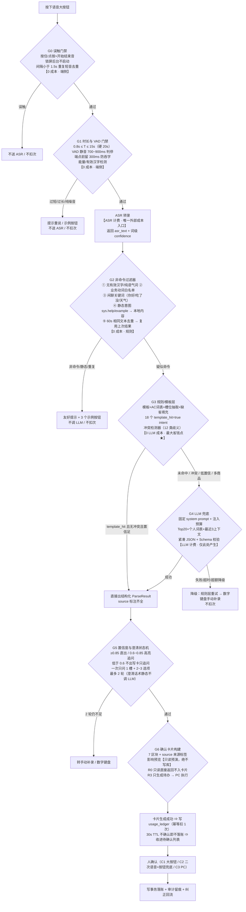

**每层判定阈值与实现手段（阈值均为【假设，需核实/需压测校准】）**

| 层 | 判定对象 | 阈值 / 规则 | 实现手段 | 成本 | 放行率（假设，需压测） |
|---|---|---|---|---|---|
| G0 | 误触 | 锁屏/后台不启动；间隔 <1.5s 重复短音去重；「按住说」+「点一下说」双模式 | 小程序 `onShow`/加速度/录音开始事件 + 本地时间戳队列 | 0 | 拦 5~10% |
| G1 | 时长/静音/能量 | 最短 0.8s；上限 15s（硬 20s 自动收音）；VAD 连续静音 700~900ms 判停；端点前留 300ms；前端倒计时；能量门限 + 有效汉字数 ≥1（送 ASR 前粗判） | 小程序 RecorderManager + 端侧 VAD（能量/过零率，或平台自带端点检测，**能力需核实**） | 0 | 拦 10~20% |
| G2 | 闲聊/环境音/无意图/重复 | 业务动词白名单（进/卖/退/盘/查/收/欠/改/撤…）；闲聊关键词表；`sys.help/example` 静态路由；60s 同 `asr_text` 哈希去重；连续 5 次无意图 → 短暂冷却（PRD 5.7 假设） | 端侧初筛 + 服务端 AC 自动机 + Redis `SETNX EX 60` 去重 | 0（不调 LLM） | 目标 **无意图过滤率 ≥90%**【PRD 8.3 假设】 |
| G3 | 标准句式 / 冲突 | 18 个 `template_hit=true` intent 模板；优先级链：危险语义（盘点/退货/金额）优先 → 通用模板；12 类冲突检测；必填槽位校验（Q 无缺省必追问） | 模板表 + 抽取器 + 缺省规则表 + `ConflictDetector` | 近 0 | 目标 **规则层命中率 ≥45%**【PRD 8.3 假设】 |
| G4 | 语义兜底 | 仅「G3 未命中 / 冲突无法确定性裁决 / 多商品拆分 / 模糊指代 / 低置信」升级 | LLM + JSON Schema 校验 + 1 次重试 + 超时降级 | **LLM 计费** | 约 ≤55% |
| G5 | 置信度 / 澄清 | ≥0.85 直出；0.6~0.85 出卡+高亮+单轮追问；<0.6 不出写卡；最多 2 轮；一次 1 槽 + 2~3 选项 | `ConfidenceCalibrator` + `ClarifyStateMachine` + 话术模板表 | 0（话术静态） | 澄清后成功率 ≥80%【PRD 8.3 假设】 |
| G6 | 确认 / 落账 | 7 区块；30s 超时不落账；C2 禁止超时自动执行；R3 只生成待办；写操作必经卡片 | `ConfirmCardBuilder` + 只读 `ImpactPreviewService` + CAS 落账 | 0（DB 只读） | 确认率 ≥90%【PRD 8.3 假设】 |

> **关键推论**：G1+G2 让「ASR 计费」只发生在疑似命令上；G3 让「LLM 计费」只发生在约 ≤55% 的有效命令上。因此**成本优化顺序 = 先砍无效录音次数 → 再砍 LLM 次数 → 最后砍单次 token**（【PRD 5.1】结论的技术化）。

### 2.2 端到端时序图（标注成本与失败分支）

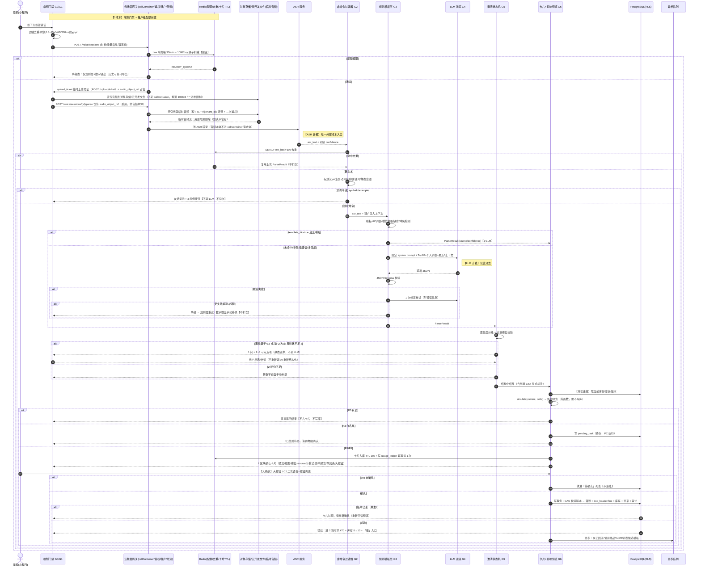

### 2.3 逐层设计

#### ① 端侧门禁（G0/G1，0 成本）

| 项 | 实现 |
|---|---|
| 录音模式 | 「按住说」+「点一下说」双模式【PRD 4.1】；锁屏/后台不启动；明显开始/结束音 |
| 时长 | <0.8s 判误触不送 ASR；>15s 自动收音；20s 硬切断；前端倒计时 |
| VAD | 连续静音 700~900ms 判停；**端点前留 300ms 防吞字**；能量门限剔除纯环境音；能力**需核实**（端侧 VAD vs 平台端点检测） |
| 去重 | 本地时间戳队列，间隔 <1.5s 的重复短音不重发；服务端 60s 文本哈希去重兜底 |
| 输出 | `VoiceSessionCreateReq{duration_ms, energy_rms, vad_tail_ms, client_fingerprint, idempotency_key}` + **`audio_object_ref`（临时 fileID/URL 引用，不传音频本体）**；`/parse` 入参改 `ParseReq{audio_object_ref, asr_text?, tokens[]}`，见下 |
| 失败分支 | 过短/过长/纯噪音 → 「没听清，再说一遍」+ 3 示例按钮；**不送 ASR、不扣次** |

##### ★ 音频上传链路重设计（v1.1 新增 · 决策卡 A5 / D11）

> **约束**：微信云托管 `callContainer` 请求体**文本 100KiB 为硬限制**；**二进制另有 20MiB 口径、超时 15s 与 60s 两处官方文档口径并存，需按实测核实**（该口径尚未实测，不写成定论）。**即便如此，仍采用 `wx.cloud.uploadFile` 直传对象存储/云开发文件 → 临时 `fileID` → 服务端只传 `audio_object_ref` 引用**：容器不持久化、音频默认不留存（D8）、官方亦建议大文件走对象存储，三者叠加后直传是唯一合理形态。**端侧 VAD / G0 / G1 门禁、时长阈值、去重、数字键盘降级路径一律不变**，只重设计「音频怎么到 ASR」这一段。

**方案对比表**

| 方案 | 链路 | 域名 / 备案影响 | 结论 |
|---|---|---|---|
| **A · 小程序 `wx.cloud.uploadFile` 直传对象存储/云开发文件 → 临时 fileID → 服务端仅传引用（推荐·采用）** | `POST /upload/ticket` 取临时上传凭证 → 小程序 `wx.cloud.uploadFile` 直传音频 → 拿 `audio_object_ref` → `callContainer` **仅传引用** → 服务端凭引用取临时音频送 ASR → 用后限期删除 | ✅ **无影响**：`wx.cloud.uploadFile` / `wx.cloud.*` **不需配服务器合法域名**，不涉及 `wx.request` 域名、不触 ICP 备案（**已核实，原域名风险关闭**） | ✅ **采用**：音频本体不进 100KiB 文本请求体、不压容器带宽、不落容器磁盘 |
| B · 端侧先送 ASR，再把文本走 `callContainer` | 小程序端直接调 ASR（或第三方端侧 ASR）→ 只把 `asr_text + 词级 confidence` 经 `callContainer` 送服务端 | 取决于 ASR 是否端侧可达（**能力需核实**） | ⚠️ **未采用**：词级 confidence / 热词注入 / 端侧算力 / 合规均**需核实**（Q1/Q3），且把 ASR 成本与端侧耦合 |
| C · `wx.uploadFile` 直传签名 URL | `wx.uploadFile` 到对象存储签名 URL → 再走 `callContainer` 传引用 | ⚠️ **`wx.uploadFile` 才需要配服务器合法域名** → 会把域名 / ICP 备案重新带回来，与 A4「免域名免备案」直接冲突 | ❌ **不采用**：`wx.cloud.uploadFile` 已满足全部需求且不需配域名；`wx.uploadFile` **本设计禁用**（零收益、纯风险） |
| D · 音频二进制/base64 直接进 `callContainer` | 音频随请求体发送 | — | ❌ **明确否决**：文本 100KiB 必超；二进制虽另有 20MiB 口径，但超时/返回体上限口径不明、官方不建议大文件走容器，且容器不持久化 |

**推荐方案 A 时序**

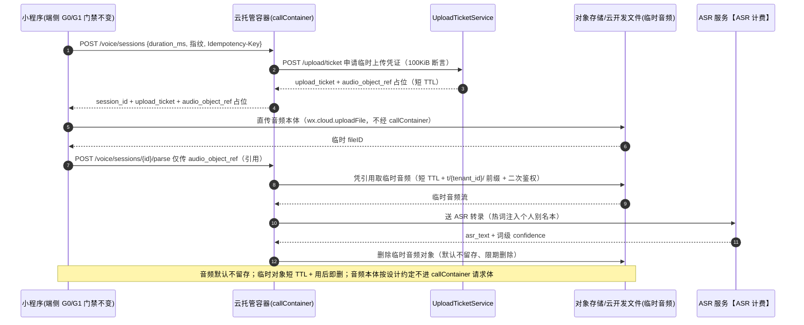

> **输出契约**：`ParseReq{audio_object_ref, asr_text?, asr_confidence?, tokens[]}`，**`audio_object_ref` 为唯一音频入口，不接收音频本体 / base64**；网关层做 100KiB 断言，超限返回 `E_AUDIO_TOO_LARGE`。**音频默认不留存**（D8），临时对象短 TTL + 限期删除（期限**需核实合规**，Q4），`voice_log` 仍只存 `asr_text`。

#### ② 服务端非命令过滤器（G2，0 成本）

**判定链（短路，任一命中即返回，不调 LLM）**：无有效汉字/纯语气词 → 闲聊关键词表 → `sys.help`/`sys.example` 静态路由 → 60s 文本去重 → 业务动词白名单 → 放行 G3。

**三种实现方式成本/效果对比（用于回答「轻量分类器/小模型是否值得」）**

| 方案 | 单次成本 | 延迟 | 可解释/可回归 | 误杀风险 | 结论 |
|---|---|---|---|---|---|
| 纯规则（关键词白名单 + 正则 + AC 自动机） | 0 | <5ms【假设需压测】 | 强 | 中（新说法漏放） | **MVP 采用**；策略「宁可放行不可误杀」，漏放的由 G3/G4 兜底 |
| 轻量分类器 / 小模型二分类 | 近 0~低（**需核实**），需推理服务 | 10~50ms【假设需核实】 | 弱 | 低-中 | **P1 可选**，仅在规则不确定（无业务动词但又非典型闲聊）时启用；保留「低置信→放行」保守策略 |
| LLM 判「是不是命令」 | 高（等于每次先付一次） | 高 | 弱 | 低 | **明确否决**：违背 H3，为省钱先花钱 |

> 另外：**闲聊判定失败最多浪费一次 ASR，误杀命令则直接丢一笔账**，二者代价不对称 → 过滤器阈值必须偏「松」。

#### ③ 规则/模板层（G3，0 LLM 成本，最大省钱点）

**模板数据结构**（`template_rule`，存 DB/JSON，带版本号与灰度开关）

| 字段 | 说明 |
|---|---|
| `template_id` / `version` / `enabled` / `priority` | 版本化、可灰度、可回滚 |
| `intent_id` | 映射到 38 intent 之一（H5） |
| `pattern` | 正则 / 槽位占位语法，如 `进了{Q}{U}{P}，{UP|TA}` |
| `domain_verbs` | 领域动词表（进/拉/到/拿…），用于前置判定 |
| `slot_extractors` | 每槽位的抽取器引用（`Q→ChineseNumberParser`、`P→AliasResolver`、`D→RelativeDateParser`） |
| `default_rules` | 引用 PRD 2.3 缺省表（`D=今天 / PS=已结 / W=主仓 / S=待补 / C=散客`） |
| `conflict_rules` | 引用 12 类冲突检测器；危险语义（盘点/退货/金额/负向词）优先级最高 |
| `risk_level` / `confirm_policy` / `template_hit` / `whitelist_blocked` | 与 intent schema 一致（H5），避免双份真相 |
| `source` / `review_status` | `builtin` / `learned`（纠正回流）/ `reviewed`；learned 默认不生效 |

**匹配优先级链**：`危险语义消解（盘点 vs 增量 / 退货方向 / 金额 vs 单价 / 负向词）` → `静态系统意图（help/example/cancel/continue/undo/teach）` → `18 个 template_hit 高频模板（按 priority 降序、最长匹配优先）` → `个人词表/别名精确命中` → `未命中 → 升级 G4`。

**与 intent schema 的映射**：模板只负责「抽取 + 填充 + 冲突裁决」，`risk_level / confirm_policy / clarifier_templates / side_effect / reversal` **一律从 `IntentRegistry` 读取**，不允许模板重复定义，防止规则层与 LLM 层行为分叉（H5 单一真相源）。模板命中后仍要与 LLM 输出走**同一个** `ParseResult` 校验器与 `ConfirmCardBuilder`（H3「省钱不省确认」）。

**从纠正回流自动扩充模板**（【PRD 5.4 / 3.9】）

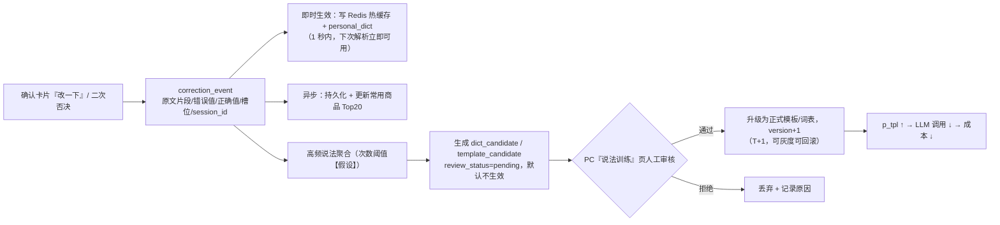

> **安全约束**：自动生成的模板**绝不自动生效**（防个别用户误操作污染规则），必须审核 + 回归测试集通过后才上线；上线走灰度与一键回滚。

#### ④ LLM 兜底（G4，唯一 LLM 计费点）

| 项 | 设计 |
|---|---|
| 触发条件 | G3 未命中 / 冲突无法确定性裁决 / 一句话多商品拆分 / 模糊指代（`再来两箱`/`还是那个客户`）/ 低置信需语义消解 |
| system prompt 结构 | ① 角色与硬规则（只输出 JSON、不解释、不得臆造换算系数与业务关键值）② **紧凑输出 JSON Schema** ③ 38 intent 的 `intent_id + 3 条样例`（动态取样，见下）④ 18 槽位字典与类型 ⑤ `source` 枚举定义 ⑥ 12 类冲突的裁决原则（尤其「还剩 = 快照设定」）⑦ 缺省值规则表 ⑧ 风险白名单（R3 只允许生成待办语义） |
| **注入预算**（H12） | 固定：system prompt（可缓存）+ intent 样例动态取样；动态：**常用商品 Top20 + 个人词表 + 最近 3 条上下文 + 当前 asr_text**；**严禁注入全量商品档案**、历史单据、其他租户数据 |
| few-shot 动态取样 | 按 `候选 intent 领域`（G3 给出的 domain hint）取 Top2~3 intent × 各 2~3 条样例；若 G3 无 hint，取全域高频 intent 各 1 条；样例来自 PRD 2.4 句式库 + 审核通过的 learned 模板，总量封顶（建议 ≤12 条【假设需核实】） |
| 输出契约 | `{"intent","slots":{...},"source":{...},"confidence":0.xx,"clarify":null\|{slot,question,options[]}}`；`source ∈ asr/default/computed/alias/pending`（H4）；金额/单位换算值必须带 `computed` 且给计算式依据 |
| 校验与重试 | Pydantic v2 / JSON Schema 强校验（intent 必须存在且非 R3 直写、必填槽位、类型、枚举、金额>0、单位在词表内）→ 失败**最多 1 次**修正重试（附校验错误）→ 仍失败走降级（G3 重试 / 手动补录），**不扣次** |
| Prompt 缓存 | 固定前缀（角色 + schema + 槽位字典 + 冲突规则 + 样例集）作为可缓存段，动态段（Top20/词表/上下文/原文）置后；缓存命中率作为核心成本指标（H12） |
| token 上限 / 超时 | `max_tokens` 硬上限（建议 200~300【假设需核实】，`response_format=json`【能力需核实】）；单次超时建议 2~3s【假设需核实】；全链路 8s【假设】；超时即降级，不无限等待 |
| 禁止项 | 不输出解释文字、不输出 Markdown、不臆造 `RATIO`、不自动选多候选中第一个、不直接执行 R3 写操作 |

#### ⑤ 置信度与澄清状态机（G5，最多 2 轮）

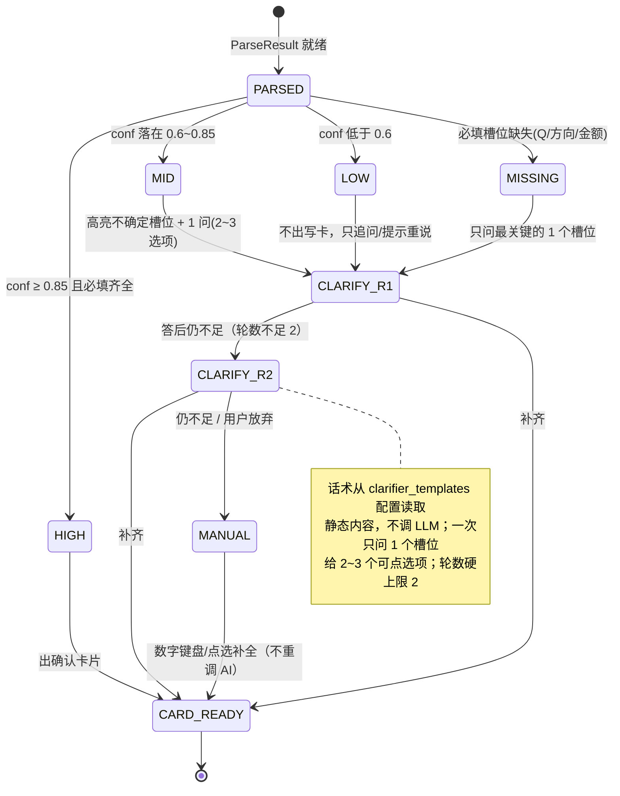

**话术模板配置化**：`clarifier_templates(intent_id, slot_code, confidence_band, template_text, options_json, priority)`；模板内变量 `{P}/{Q}/{date}` 由槽位填充；示例见【PRD 4.2】。**用户点选/补说后的修补只做本地结构化更新，不重新调用 AI**（【PRD 3.7】：编辑不重调 AI，省钱 + 即时反馈）。

#### ⑥ 确认卡片数据契约（G6，`source` 与「影响预览」只读预演）

**卡片 7 区块 ↔ 数据字段映射（H10）**

| 区块 | 字段 | 来源 |
|---|---|---|
| ① 原文区 | `asr_text`, `asr_confidence`, `low_confidence_highlight` | ASR + 校准器 |
| ② 意图区 | `intent_label_zh`, `domain`, `risk_level` | `IntentRegistry` |
| ③ 槽位表 | `slots[] {code, value, display, source, editable}` | `SlotFiller`；`source` 决定是否加底色/角标 |
| ④ 计算式 | `calc_traces[]`（如 `2箱×35=70`、`2箱→48瓶(1箱=24瓶)`、`三箱共210，折合每箱70`） | `AmountCalculator` + `UnitConverter` |
| ⑤ **影响预览** | `impact_preview[] {entity, before, delta, after, version}` | **只读预演**（下方详述） |
| ⑥ 风险条 | `risk_banner{level, reason_zh}` | R0~R3 / C0~C3 / 冲突标记 / 低置信 |
| ⑦ 操作区 | `primary_label`（动态带关键值，如「确认入库 2 箱可乐 ¥70」）、`actions[]`、C2 的按钮兜底 | `ConfirmCardBuilder` |

**`source` 枚举与回显要求（H4/H6）**

| source | 含义 | 卡片表现 |
|---|---|---|
| `asr` | 直接识别 | 正常 |
| `default` | 缺省补全（`D=今天` 但显示**具体日期**、`PS=已结`、`W=主仓`、`S=待补`、`C=散客`） | 浅色底 + 「缺省补全」角标；`S=待补` 必须显式标 |
| `computed` | 换算/反算得到（单位换算、总价反算单价） | 浅色底 + 「换算得到」+ **必须展示计算式** |
| `alias` | 个人词表/别名命中 | 「按你的习惯」角标 |
| `pending` | 待确认（多候选、无换算系数、老价无历史） | 黄色「待确认」，**不得静默填值** |

**影响预览 = 只读预演（H1/H9/决策 D9，最关键约束）**

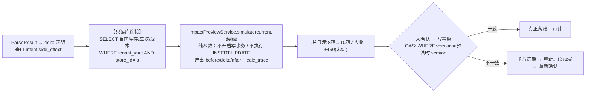

- **物理保证**：预演查询走**只读数据库角色 / 只读连接串**，DB 层无 INSERT/UPDATE 权限，即使代码写错也写不进去。
- **逻辑保证**：`simulate()` 为无副作用纯函数，输入仅 `current_state + delta`，输出 `projected_state`，便于单测。
- **并发保证**：落账时 CAS 校验 `inventory.version` / `ar_ap.version`；不匹配则不允许按旧态写，卡片标「已过期」重新预演（不静默覆盖）。
- **R0 例外**：只读查询直接返回结果，**不构建卡片、不写库、不扣确认位**（H2）。
- **R3 例外**：只写 `pending_task`（待办），卡片显示「请在电脑端确认」，**不产生任何业务写**（H8）。

---

### 2.4 AI 成本工程

#### 2.4.1 单次有效命令成本估算公式（符号化，避免写死报价）

**定义**

| 符号 | 含义 |
|---|---|
| `N_rec` | 总录音次数（含无效） |
| `p_g1`, `p_g2` | G1 端侧过滤率、G2 非命令过滤率（目标 `p_g2≥90%`【PRD 8.3 假设】） |
| `p_tpl` | 规则层命中率（目标 `≥45%`【PRD 8.3 假设】，**毛利主杠杆**） |
| `p_card` | 进入解析的录音中成功生成确认卡片的比例 |
| `C_asr` | 单次 ASR 成本 = `T_audio × c_asr`（`c_asr` 按秒/按次，**需核实**） |
| `C_llm` | 单次 LLM 解析成本（下式展开） |
| `k̄` | 平均澄清轮数（0~2 硬上限，【PRD 5.2】） |
| `C_clarify` | 单轮澄清增量成本（话术静态 0；仅当修补需要再解析时 >0） |
| `C_infra` | 单次摊销（**外挂托管数据库/缓存连接与实例摊销**、容器带宽/计算、**对象存储临时音频上传 + 限期删除**、导出文件存储，【假设需核实】；外挂访问延迟/成本见 §4.5 / Q22） |

```
① 单次 LLM 解析成本（token 口径，全部单价需核实）
C_llm = (T_sys × c_cache + (T_ctx + T_utt) × c_in) + T_out × c_out
  T_sys  : 固定 system prompt（prompt 缓存段，c_cache 通常为 c_in 的折扣，需核实）
  T_ctx  : 注入预算 = Top20 商品 + 个人词表 + 最近 3 条上下文（严禁全量档案）
  T_utt  : asr_text
  T_out  : 紧凑 JSON（硬上限 max_tokens）

② 单次「有效语音记账」综合成本（计费口径：成功生成卡片的录音）
C_cmd = C_asr / p_card
      + (1 − p_tpl) × C_llm
      + k̄ × C_clarify
      + C_infra

③ 全平台总成本（用于成本归因与告警）
C_total = N_rec × (1 − p_g1) × (1 − p_g2) × C_asr
        + N_rec × (1 − p_g1) × (1 − p_g2) × p_card × (1 − p_tpl) × C_llm
        + N_clarify × C_clarify
        + C_fixed
```

**示例代入（沿用 PRD 6.4 / 8.3 的假设值，非预测、全部需核实）**

```
假设：C_asr = ¥0.004，C_llm = ¥0.02（PRD 6.4 假设，需核实）
      p_tpl = 45%（PRD 8.3 目标），k̄ = 0.3（假设，需压测），C_clarify ≈ 0
      p_card = 0.9（假设，需压测），C_infra ≈ 忽略
C_cmd ≈ 0.004/0.9 + 0.55 × 0.02 + 0
      ≈ 0.0044 + 0.0110 ≈ ¥0.0154   → 落在 ≤¥0.02 目标内【假设，需核实】
若 p_tpl 降到 30%：C_cmd ≈ 0.0044 + 0.70 × 0.02 ≈ ¥0.0184（+19%）
若 p_tpl 升到 60%：C_cmd ≈ 0.0044 + 0.40 × 0.02 ≈ ¥0.0124（−19%）
⇒ 与 PRD 6.4 结论一致：规则层命中率是毛利第一杠杆。
```

#### 2.4.2 ≥5 条可落地降本手段及预期影响（影响幅度均为【假设，需压测】）

| # | 手段 | 作用层 / 公式项 | 预期影响 | 落地要点 |
|---|---|---|---|---|
| 1 | 端侧门禁 + 非命令过滤（G0/G1/G2） | `N_rec × (1−p_g1)(1−p_g2) × C_asr` | 无效 ASR 调用 **−20~35%**；`p_g2≥90%` 目标 | 业务动词白名单 + 60s 文本去重 + 静态意图本地路由；**宁可放行不可误杀** |
| 2 | 规则/模板层优先（G3） | `(1 − p_tpl) × C_llm` | LLM 调用次数 **−45%**（目标命中率） | 18 个 `template_hit` 模板 + 纠正回流扩模板；模板命中**照样出确认卡片** |
| 3 | Prompt 缓存 + 注入预算（H12） | `T_sys × c_cache`、`T_ctx` | 单次输入 token **−50~70%** | 固定前缀可缓存；仅 Top20+个人词表+最近 3 上下文；禁止全量商品档案 |
| 4 | 紧凑 JSON 输出 + `max_tokens` + 禁解释 | `T_out × c_out` | 输出 token **−40~60%** | 强 Schema 校验 + `response_format=json`（能力需核实）+ 硬上限 |
| 5 | 60s 去重缓存 + 计费幂等 | 重复解析次数 | **−3~8%** 调用 | Redis `SETNX` + `usage_ledger` 唯一约束 |
| 6 | 澄清最多 2 轮 + 一次 1 槽 + 静态话术 + 编辑不重调 AI | `k̄ × C_clarify` | 澄清成本**封顶**，编辑成本 = 0 | `ClarifyStateMachine` 硬上限；卡片编辑本地重算金额与影响预览 |
| 7 | 静态意图零 LLM（help/example/cancel/continue） | 直接消去 `C_llm` | 高频系统指令 100% 免去 | G2 前置路由到本地内容表 |
| 8 | ASR 热词注入个人别名本 | 降低低置信率 → 降 `k̄` 与二次解析 | 口音场景澄清率下降（幅度需压测） | 依赖 ASR 热词能力**需核实**；热词随 `sys.teach` 即时更新 |
| 9 | 纠正回流 → 模板/词表覆盖度↑ | `p_tpl` 随时间↑ | 长期结构性降本（「越用越省」） | 候选模板需审核生效，见 §2.3③ |
| 10 | 模型降级 + 超额降级（H14） | 高负载/超额时 `C_llm→0` | 保住毛利不保功能 | 见下表；历史数据不锁 |
| 11 | 长任务异步化（报表/导出/回流/销户） | 不占实时 LLM 链路 | 削峰、避免重复解析 | 队列 + 结果缓存 |
| **12（v1.1）** | **音频直传对象存储/云开发文件、仅传引用**（D11） | `C_infra`（容器带宽/计算、临时音频存储） | **避免音频进 `callContainer` 触发 100KiB 文本上限拆包与二进制开销**，容器带宽与内存下降（幅度**需压测**）；临时对象限期删除不留长期存储 | 端侧 VAD/门禁不变；`audio_object_ref` 引用 + 100KiB 断言；`wx.cloud.uploadFile` **不需配服务器合法域名**（已核实），`wx.uploadFile` 禁用 |

#### 2.4.3 模型降级策略（与 PRD 5.6 对齐）

| 档位 | 触发 | 可用能力 | 成本 | 用户可感知 |
|---|---|---|---|---|
| L0 正常 | 额度 <80% | 主模型 + 规则层 + 澄清 + 二次确认 | 全额 | 全功能 |
| L1 温和提示 | 额度 ≥80%【假设】 | 同 L0，仅提示余额 | 全额 | 不打断录入 |
| L2 轻量模型 | 高负载 / 成本告警 / 主模型超时 | 轻量模型兜底 + 规则层优先 | 降低（幅度**需核实**） | 复杂句式可能转澄清 |
| L3 超额降级 | 额度 ≥100% 未付费 | **仅规则/模板 + 数字键盘手动补录**（进/销/退/盘/查/收）；锁 LLM 语义、一句话多商品、多轮澄清、报表语音 | `C_llm = 0` | **账本不停**；提示「语义理解暂歇，仍可记账」 |
| L4 异常熔断 | 风控触发 | 暂停**新解析**；历史数据可查、可导出、可编辑 | 0 | 临时限流，**绝不删数据** |
| 恢复 | 购买权益后 / 加油包 / 风控解除 | 回到 L0 | — | 无需迁移数据 |

#### 2.4.4 批量与缓存策略

| 层 | 策略 |
|---|---|
| Prompt 缓存 | 固定前缀哈希 → 供应商缓存（能力/折扣**需核实**）；缓存命中率纳入监控 |
| 解析结果缓存 | `text_hash + tenant_id + dict_version + intent_registry_version` 为 key，60s TTL；**词表/模板版本变更即失效**（防止 `sys.teach` 后仍用旧结果） |
| 词表热缓存 | Redis 存个人词表/Top20，`sys.teach` 与纠正回流即时双写（DB + Redis），避免下次解析读旧值 |
| 只读查询缓存 | 库存/欠款查询短 TTL（建议 5~10s【假设】），写事务后按 key 主动失效 |
| 批量 | 报表聚合、导出、词表频次统计、候选模板生成走异步队列与离线批；**实时链路不做批量** |
| 卡片缓存 | Redis TTL 30s，超时转「待确认」列表持久化，不丢数据 |

#### 2.4.5 租户级配额与限流实现（H13/H14）

| 项 | 实现 |
|---|---|
| 维度 | key 前缀强制 `t:{tenant_id}:quota:*`；单租户超额不影响他户（H13） |
| 算法 | Redis **Lua 令牌桶原子脚本**：`30 次/分`、`1000 次/天`【PRD 5.7 假设】；另设「连续 5 次无意图 → 短暂冷却」计数器 |
| 前置检查 | 在 `POST /voice/sessions` 网关层执行，**早于 ASR 调用**，避免超额后仍产生 ASR 费用 |
| 幂等 | `idempotency_key = voice_session_id`；网关 `SETNX` 防重放；`usage_ledger UNIQUE(tenant_id, voice_session_id, event_type)` 兜底 |
| 扣次时机 | **仅 `ConfirmCard` 生成成功**时，与卡片写入**同一事务**写 `event_type=CARD_CREATED`；失败/无意图/取消/解析失败 **不写计费事件**（H13） |
| 可见性 | `GET /usage` 返回「本月已用 / 免费额度 / 当前档位 / 降级状态」；落账轻提示剩余 |
| 新账号防薅 | 设备 + 手机号维度限制试用额度（合规**需核实**） |

#### 2.4.6 成本监控、告警与异常用量熔断

| 指标 | 口径 | 告警条件（阈值为【假设，需核实】） |
|---|---|---|
| `p_tpl` 规则层命中率 | 未调 LLM 即结构化 / 进入解析 | 低于 40% 连续 1h → 告警（毛利直接受损） |
| `p_g2` 无意图过滤率 | 非命令被拦 / 非命令总数 | 低于 90% → 检查闲聊词表 |
| `LLM 调用 / 有效命令` | 应 ≈ `1 − p_tpl` | 显著偏高 → 检查模板失效/缓存击穿 |
| 平均 `T_in` / `T_out` / 缓存命中率 | 按调用统计 | 缓存命中率骤降、注入预算超上限（Top20 膨胀）→ 告警 |
| 单租户日成本 TopN | 按 `usage_ledger` 归因 | 超基线 N 倍 / 5σ → 风控 |
| 日成本环比 | 平台总成本 | 突增 >50% → 告警 |
| 配额拒绝次数 / 冷却触发数 | Redis 计数 | 突增 → 排查刷量或误杀 |
| 卡片生成失败率 / 降级次数 | 状态机统计 | 升高 → 检查 LLM 供应商或 Schema 变更 |

**熔断分级**：`提示 → 单租户限流 → 临时冻结该租户新解析 → 人工复核`，全程**不删数据、不锁历史查询与导出**（H14）。平台级熔断需保留规则层与手动补录通道。

---

## 3. 口音与容错的技术实现

### 3.1 ASR 置信度的取得与校准

| 步骤 | 设计 |
|---|---|
| 取得 | 优先选择返回**词级/句级 `confidence`** 的 ASR（能力**需核实**）；`AsrProvider` 适配器统一输出 `AsrResult{text, tokens[{word, conf, start_ms, end_ms}], overall_conf}` |
| 槽位级置信度 | 若只有词级：槽位置信度 = 该槽位覆盖 token 的 **最小值**（保守，取短板）而非平均；数量/金额/方向等关键槽位单独标 `low_conf=true` |
| 校准 | 原始 score ≠ 真实概率。用自建标注集（用户授权采集的脱敏语音 + 人工标注正确文本）做**分桶校准 / Platt scaling**，按「噪声等级、业务域、设备」分层得到映射表 `calibration_table`，输出可解释概率；校准集规模与效果**需核实/需实测** |
| **无 confidence 的兜底** | 构造代理置信度 `conf_proxy = w1·规则模板命中 + w2·业务动词命中 + w3·槽位完整度 + w4·文本通顺度(困惑度/乱码比) − w5·同音异常`；阈值同样按 ≥0.85 / 0.6~0.85 / <0.6 分级【假设需校准】 |
| 分级动作 | ≥0.85 直出卡片；0.6~0.85 出卡 + 高亮不确定槽位 + 单轮追问；<0.6 **不出写操作卡片**，只追问/提示重说（【PRD 4.2】） |
| 与成本联动 | 低置信 → 追问（静态话术 0 成本）→ 不轻易重跑 ASR/LLM；连续低置信达阈值 → 引导数字键盘手动补录 |

### 3.2 数字 / 金额归一表：数据结构与匹配算法

**表结构 `num_normalization_rules`（三层词表之一：全局基础归一表；个人层存 `personal_dict`）**

| 字段 | 说明 | 示例 |
|---|---|---|
| `rule_id`, `layer` | `global` / `industry` / `personal` | |
| `tenant_id`, `member_id` | 个人层归属；全局层为空 | |
| `pattern` | 正则 / 字面 / Trie 词条 | `一百二`、`两块五`、`幺件` |
| `normalized` | 归一值 | `120`、`2.5`、`1` |
| `value_type` | `integer` / `decimal` / `amount` / `candidate_set` | `三五` → `candidate_set[35, 3.5, 3+5]` |
| `context_constraint` | 语境约束：前置/后置词、所在槽位类型 | 后接「箱」→ Q；后接「块/元」→ 金额 |
| `priority` | 优先级：**个人 > 行业 > 全局**（【PRD 3.9】） | |
| `ambiguity_policy` | `accept` / `show_calc_trace` / `clarify` | 「一百二」按 120 但**高亮让用户核**；「三五」→ 澄清 |
| `enabled`, `source` | 审核状态与来源 | |

**匹配算法（分层、确定性、可回归）**

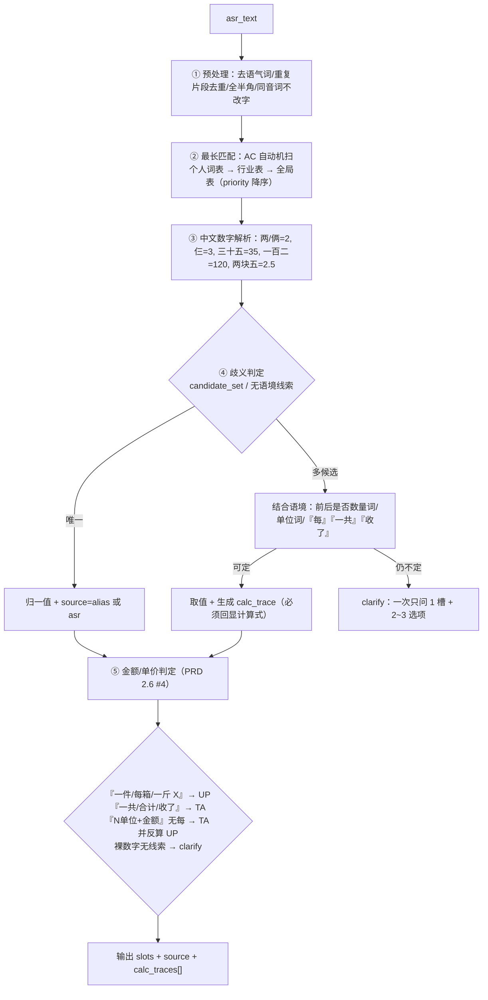

> 「幺=1 / 拐=7 / 勾=9」等口语/军语读法是否纳入**需核实**（【PRD 2.6 #8 / 4.1】）；「一百二」按 120 处理但**必须高亮让用户核验**；「三五」不得自作主张。所有归一结果进入 `calc_traces`，供卡片④区块展示计算式让用户验算。

### 3.3 别名 / 简称模糊匹配方案选型（含选型理由）

| 方案 | 成本 | 延迟 | 短别名效果 | 可解释性 | 运维 | 结论 |
|---|---|---|---|---|---|---|
| **归一化 + 编辑距离 + 拼音(全拼/首字母) + Trie/AC 自动机** | 0（纯本地） | 极低 | **好**（「娃哈」→娃哈哈、「大绿棒子」靠词表） | 强（可给分差） | 低 | **MVP 采用** |
| 向量检索（embedding + 向量库） | 每次需 embedding 调用或离线索引（**需核实**成本） | 中 | 一般（短口语词向量易漂移） | 弱 | 高（索引/版本/漂移） | **P2 再评估** |
| LLM 直接消歧 | 高 | 高 | 好 | 弱 | 低 | 仅作 G4 兜底，不做召回 |

**选型理由**：① 候选集极小——常用商品 Top20 + 个人词表 + 租户商品档案，通常 <500 条（【假设，需压测】），精确匹配 + 编辑距离 + 拼音召回已足够，无需向量索引；② 每次 embedding 调用本身就要钱，与 H18 成本目标冲突；③ 别名是**字面/读音**相似（「娃哈」「快乐水」「二中门口那家」），不是语义相似，向量召回反而可能引入不相关商品；④ 编辑距离可解释、可给「Top1/Top2 分差」用于消歧决策，便于单测与审计。

**候选打分公式**：`score = w1·字面相似 + w2·拼音相似 + w3·历史使用频次 + w4·上下文(最近单据/门店/连续录单 CTX) + w5·ASR 置信度`（权重**需实测校准**）。

**多候选消歧规则（【PRD 2.6 #5】）**：`Top1 − Top2 < δ` 或并列 → **出候选卡片点选，绝不自动选第一个**；选择结果即时回流 `personal_dict`（`source=alias`，卡片标「按你的习惯」）。同名多规格（大瓶/小瓶可乐）同样走点选。

### 3.4 低置信澄清状态机与话术配置化

- 状态机见 §2.3⑤；硬约束：**一次只问 1 个最关键槽位**（通常是 Q 或方向）、给 **2~3 个可点选项**、**绝不自作主张填业务关键值**（Q/方向/金额/对象）、**单会话最多 2 轮**。
- `clarifier_templates` 配置化字段：`intent_id, slot_code, confidence_band, template_text, options_json(2~3), priority, enabled`；示例话术直接落地【PRD 4.2】8 条（如「进了**可乐**，几箱啊？」「是**退给供货商**，还是**客户退回来**？」「一箱是几瓶？说一次我就记住了」）。
- 话术为**静态内容，不调 LLM**（H12）；模板变量由槽位填充；方言友好、短句。
- 澄清答复的修补走本地结构化更新，**不重新调用 AI**；超过 2 轮转数字键盘手动补录。

### 3.5 纠错回流的数据写入路径与生效时序（【PRD 3.9】）

| 差异类型 | 回流内容 | 写入表 | 生效时序 |
|---|---|---|---|
| 商品别名 | 原文片段 → 正确商品 | `personal_dict` + `product_alias` | **即时（<1s）** |
| 单位换算说法 | 「一箱=24 瓶」说法进待教学队列 | `dict_candidate` → PC 确认后写 `unit_conversion`（设置系数本身 R3/PC） | 说法即时入队；**系数需 PC 审核** |
| 数字读法 | 「幺/两/俩/三五」→ 数值 | `personal_dict`（layer=personal） | 即时 |
| 客户/供应商简称 | 「二中门口那家」→ 兴旺超市 | `personal_dict` / `partner_alias` | 即时 |
| 缺省偏好 | 90% 现结 / 常用某仓 | `member_pref`（需频次阈值） | T+1 统计后 |
| 常用商品 | 高频录入商品 | `product_freq` → Top20 重排 | T+1（或异步分钟级） |
| 高频句式 | 同一说法重复出现 | `template_candidate`（`review_status=pending`） | **审核后 T+1，灰度上线** |

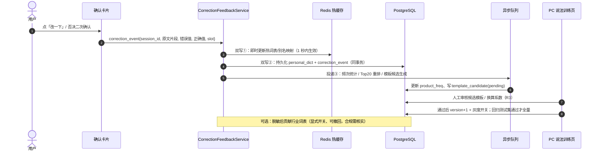

> **即时生效保证**：解析前先从 Redis 读 `personal_dict@version`，`sys.teach` 与纠错双写 DB+Redis；解析缓存 key 含 `dict_version`，**版本变更自动击穿缓存**，避免用了旧词表还展示「按你的习惯」。

### 3.6 「越用越准 → 越用越省」闭环

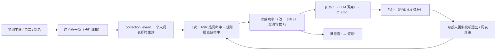

| 闭环指标 | PRD 出处 | 技术观测点 |
|---|---|---|
| 语音一次成功率 ≥85%（成熟）/ ≥70%（新）【假设】 | 8.3 | `confirm_card.edit_count=0 且 confirmed` 占比 |
| 「改一下」率 ≤15% 且逐周下降【假设】 | 8.3 | `correction_event` / 卡片数 |
| 规则层命中率 ≥45%【假设】 | 8.3 | `parse_channel=template` 占比 |
| 单条命令成本 ≤¥0.02【假设需核实】 | 8.3 | `usage_ledger` 成本归因 |
| 澄清后成功率 ≥80%【假设】 | 8.3 | `ClarifyStateMachine` 终态 |
| 撤销率 ≤3%【假设】 | 8.3 | `reversal` / 落账数（影响预览是否有效） |

### 3.7 何时升级到「手动补录 / 数字键盘」（降级路径）

| 触发 | 动作 |
|---|---|
| `conf < 0.6` 且 2 轮澄清仍不足 | 转数字键盘（大号数字键盘 + 常用商品点选网格），**不调 AI** |
| 连续 N 次无意图（建议 5 次【假设】） | 短暂冷却 + 3 个示例按钮引导 |
| 单位换算缺失且用户不愿教 | 先按基本单位记账 + 说法进「待教学」队列，PC 补系数（**绝不臆造 RATIO**） |
| 超额降级 L3 / 异常熔断 L4 | 仅规则层 + 手动补录，账本不停 |
| ASR 连续失败 / 供应商超时 | 直接给手动补录入入口，不循环重试 |
| 用户主动点「改一下」 | 卡片内编辑，本地实时重算金额与影响预览，**不重调 AI** |
| 多候选点选 | 点选即回流，不额外解析 |

> 【PRD 4.4】产品承诺「听不懂会问你，改一次就记住」，且**全程只用按钮 + 数字键盘也能记账**——这是首日可用性的技术底线。

---

## 4. 多租户技术决策（用户明确问「是不是要做成多租户」）

### 4.1 明确结论

> **结论：要做，从第一天做「数据模型多租户 + 产品体验单商户」。**
> 推荐 **共享库共享表 + `tenant_id` + PostgreSQL RLS（数据库强制） + 应用层 ORM 全局 scope（双保险）**；MVP 只建 1 个 Tenant / 1 个 Store、UI 不暴露门店与组织概念；升级多门店只新增 Store 行与数据归属，**不迁移数据、不改历史单号**（H16/H17）。
>
> **v1.1 补充（决策卡 A5）**：**微信云托管不内部署有状态服务、容器不持久化** → 上述 PostgreSQL（RLS）+ Redis 不能跑在容器内；落地方式见 **§4.5「云托管下的数据层落地方案」**：推荐**方案 A 外挂托管 PostgreSQL（保留 RLS + 九道防线）**，备选**方案 B 云开发数据库（RLS 不可用时须补应用层替代并如实标注隔离强度下降）**，或**方案 C 混合**。隔离结论（共享库 + `tenant_id` + 登录态）不变，**绝不「一客户一域名」**（D15）。

**隔离级别三方案对比**

| 维度 | ① 共享库共享表 + `tenant_id` + RLS（**推荐**） | ② 共享库分 schema | ③ 独立库 / 独立实例 |
|---|---|---|---|
| 成本 | **最低**（单实例、连接池复用） | 中（schema 数膨胀、迁移复杂） | 高（每租户实例/连接/备份） |
| 隔离强度 | 中-高（**RLS 强制**，漏加条件也查不到） | 高（schema 边界） | **最高**（物理隔离） |
| 运维 | **最简**（一套迁移、一套监控） | 中（DDL 需遍历 schema，版本漂移风险） | 重（N 套迁移/备份/升级） |
| 迁移/升级多门店 | **零迁移**（只加 `store_id`） | 需新建 schema | 需新建库 |
| 跨租户汇总 / 平台运营 | 方便（受控聚合） | 需跨 schema 联合 | 需 ETL |
| 单表数据量风险 | 随租户增长需分区（**演进点 E2**） | 天然分散 | 天然分散 |
| 故障爆炸半径 | 大（单库故障全平台） | 中 | 小 |
| 适用规模 | **大量小微租户（本产品）**【PRD 6.6 假设】 | 中型 / 有合规分域要求 | 大客户 / 强合规 / 私有化 |
| 数据泄露根因 | 应用漏加条件（已被 RLS 兜住） | 连接串切错 schema | 连接串切错库 |

> **④ 云开发数据库方案（v1.1 补充 · 决策卡 A5 / D7）**：云托管不内部署有状态服务，可选「云开发数据库」替代外挂 PostgreSQL。此方案**无 PostgreSQL RLS**，隔离改靠**数据库安全规则 + 应用层 `TenantRepository` 强制 scope + 唯一索引以 `tenant_id` 打头 + CI 静态扫描 + 双租户越权单测**五件套；优点是免外挂实例、与云开发云函数/发货回调同生态，缺点是**隔离强度明确下降**（只剩应用层 + 规则 + 规范 + 测试），且事务粒度、CAS 乐观锁、部分索引能力**需核实**（Q21）。完整对比与决策建议见 **§4.5**。

**演进路径**：`MVP ① + RLS` → `P1 按 tenant_id 哈希分区 + 只读副本` → `P2 大客户可选 ③ 独立库（通过连接路由层，业务代码不改）`。**关键设计**：所有数据访问经 `TenantContext + Repository` 抽象，隔离级别升级对业务层透明。

### 4.2 租户识别链路与「防越权 / 防漏加条件」

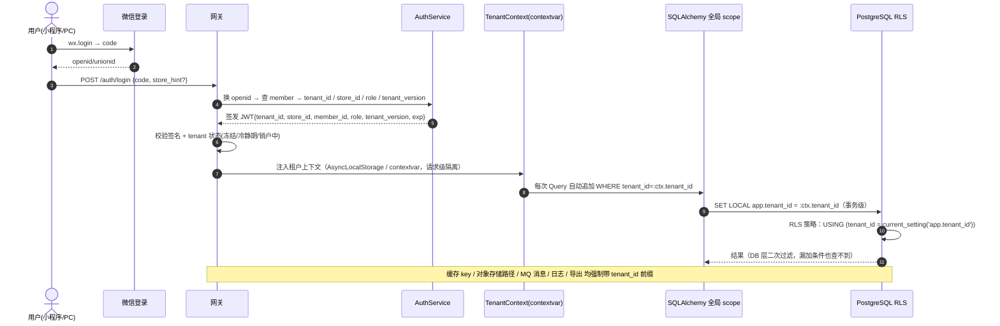

**九道防线（防止越权与漏加条件）**

| # | 防线 | 实现 |
|---|---|---|
| 1 | **DB 层 RLS**（**仅 §4.5 方案 A 外挂托管 PostgreSQL 适用**；**方案 B 云开发数据库无 RLS，以「数据库安全规则」替代，隔离强度下降，须在验收与运维手册如实标注**） | 所有业务表启用 `ENABLE ROW LEVEL SECURITY` + `FORCE`；策略 `USING (tenant_id = current_setting('app.tenant_id')::uuid)`；应用账号**非 BYPASSRLS**；迁移/运维用独立超级账号 |
| 2 | **应用层 ORM 全局 scope** | SQLAlchemy `do_orm_execute` 事件钩子自动注入 `tenant_id` 过滤；写入自动填 `tenant_id`，禁止业务代码手工传 |
| 3 | 上下文强制传递 | `TenantContext` 用 contextvar；**异步队列 / 定时任务 / 导出 Job 必须显式携带 tenant_id**（最易漏点），缺失即抛异常而非默认全量 |
| 4 | 缓存 key 规范 | 统一 `t:{tenant_id}:{store_id}:{biz}:{id}` 前缀，封装为 `TenantCache`，禁止裸 key |
| 5 | 对象存储 | 路径前缀 `t/{tenant_id}/...`；临时签名 URL 短 TTL + 二次鉴权；导出文件不含跨租户数据 |
| 6 | 唯一约束/索引 | 所有唯一索引与联合索引**以 tenant_id 打头**（如 `UNIQUE(tenant_id, doc_no)`），避免跨租户单号冲突也避免误查 |
| 7 | 代码规范 + 静态扫描 | 禁用裸 SQL 字符串拼接；CI 用 lint/AST 规则扫描「SELECT/UPDATE/DELETE 未带 tenant_id」与「直接 session.execute(原生 SQL)」；**PR 门禁** |
| 8 | 自动化测试 | 每个 Repository 测试夹具强制 **两租户 + 两门店**，跑「A 租户查 B 数据应为空 / 越权写应抛错」；R3 待办与导出必须有跨租户用例；回归测试集含 RLS 开关校验 |
| 9 | 审计与巡检 | `audit_log` 记 `tenant_id/member_id/action/entity/ip`；定期巡检异常跨租户访问模式；权限最小化（店员不可见利润与客户电话【PRD 7.2】，字段级脱敏在 API 序列化层按 role 过滤） |

> **角色权限落点**：`Role` 决定「可见与可改范围」，在**网关（路由级）+ 序列化层（字段级）+ 服务层（动作级）**三处校验；R3 白名单动作额外要求 `role=老板` 且来源为 PC（H8）。

### 4.3 核心数据模型

#### 4.3.1 ER 图（主要实体与归属）

```mermaid
erDiagram
  TENANT ||--o{ STORE : "owns"
  TENANT ||--o{ MEMBER : "employs"
  TENANT ||--o{ PRODUCT : "tenant级共享"
  TENANT ||--o{ PARTNER : "tenant级共享"
  TENANT ||--o{ USAGE_QUOTA : "配额"
  TENANT ||--o{ DELETION_REQUEST : "销户"
  STORE ||--o{ INVENTORY : "门店级"
  STORE ||--o{ DOC_HEADER : "门店级"
  STORE ||--o{ VOICE_LOG : "门店级发生"
  MEMBER ||--o{ ROLE : "assigned"
  MEMBER ||--o{ PERSONAL_DICT : "员工级"
  MEMBER ||--o{ VOICE_SESSION : "发起"
  PRODUCT ||--o{ PRODUCT_ALIAS : "别名"
  PRODUCT ||--o{ UNIT_CONVERSION : "换算系数"
  PRODUCT ||--o{ INVENTORY : "库存"
  PRODUCT ||--o{ DOC_LINE : "明细"
  PARTNER ||--o{ AR_AP : "往来"
  DOC_HEADER ||--o{ DOC_LINE : "1:N 明细"
  DOC_HEADER ||--o{ REVERSAL : "被反做/反做单"
  DOC_HEADER ||--o{ PAYMENT : "收付"
  VOICE_SESSION ||--o| VOICE_LOG : "ASR与解析留痕"
  VOICE_SESSION ||--o| CONFIRM_CARD : "生成卡片"
  VOICE_SESSION ||--o| USAGE_LEDGER : "幂等计费"
  VOICE_SESSION ||--o{ CORRECTION_EVENT : "纠错回流"
  CONFIRM_CARD ||--o{ PENDING_TASK : "R3 转待办"
  AR_AP ||--o{ PAYMENT : "核销"
  USAGE_QUOTA ||--o{ USAGE_LEDGER : "汇总"
  TENANT ||--o{ ENTITLEMENT : "权益有效期(v1.1)"
  TENANT ||--o{ VIRTUAL_ORDER : "虚拟支付下单(v1.1)"
  GOODS_ITEM ||--o{ VIRTUAL_ORDER : "道具定义"
  VIRTUAL_ORDER ||--o| DELIVER_EVENT : "发货推送(幂等去重)"
  DELIVER_EVENT ||--o| ENTITLEMENT : "加额度/延长有效期"
  ENTITLEMENT ||--o{ USAGE_QUOTA : "付费额度来源(与语音消耗分离)"

  TENANT {
    uuid tenant_id PK
    string name
    string plan_code
    string status "active/frozen/deleting"
    int quota_monthly
    timestamptz created_at
  }
  STORE {
    uuid store_id PK
    uuid tenant_id FK
    string name
    bool is_main
    string status
  }
  MEMBER {
    uuid member_id PK
    uuid tenant_id FK
    string wx_openid UK
    string name
    string phone_enc
  }
  ROLE {
    uuid role_id PK
    uuid tenant_id FK
    uuid member_id FK
    uuid store_id FK "可空=全店"
    string role_code "boss/manager/clerk/readonly"
  }
  PRODUCT {
    uuid product_id PK
    uuid tenant_id FK
    string name
    string base_unit
    numeric last_purchase_price
    numeric last_sale_price
    string status "active/disabled"
  }
  PRODUCT_ALIAS {
    uuid alias_id PK
    uuid tenant_id FK
    uuid product_id FK
    uuid member_id FK "空=租户级"
    string alias_text
    string source "personal/industry/global"
  }
  UNIT_CONVERSION {
    uuid conv_id PK
    uuid tenant_id FK
    uuid product_id FK
    string from_unit
    string to_unit
    numeric ratio "不可臆造"
    string status "pending/approved"
  }
  PARTNER {
    uuid partner_id PK
    uuid tenant_id FK
    string type "customer/supplier"
    string name
    string phone_enc
    string status
  }
  INVENTORY {
    uuid inventory_id PK
    uuid tenant_id FK
    uuid store_id FK
    uuid product_id FK
    numeric qty_base
    int version "CAS 乐观锁"
  }
  DOC_HEADER {
    uuid doc_id PK
    uuid tenant_id FK
    uuid store_id FK
    string doc_no "租户内唯一"
    string intent_id
    string doc_type
    date biz_date
    string payment_status
    numeric total_amount
    string status "confirmed/reversed"
    uuid reversed_by FK
  }
  DOC_LINE {
    uuid line_id PK
    uuid tenant_id FK
    uuid doc_id FK
    uuid product_id FK
    numeric qty
    string unit
    numeric unit_price
    numeric amount
    jsonb source_map "每槽位 source"
  }
  AR_AP {
    uuid ar_ap_id PK
    uuid tenant_id FK
    uuid store_id FK
    uuid partner_id FK
    uuid doc_id FK
    string direction "receivable/payable"
    numeric amount
    numeric settled_amount
    int version
  }
  PAYMENT {
    uuid payment_id PK
    uuid tenant_id FK
    uuid ar_ap_id FK
    numeric amount
    string method
    date biz_date
  }
  VOICE_SESSION {
    uuid session_id PK "幂等键"
    uuid tenant_id FK
    uuid store_id FK
    uuid member_id FK
    string state
    int clarify_round
    timestamptz expires_at "卡片 30s"
  }
  VOICE_LOG {
    uuid log_id PK
    uuid tenant_id FK
    uuid session_id FK
    text asr_text "不存音频"
    numeric asr_confidence
    string parse_channel "template/llm/filtered"
    jsonb parse_result
    int llm_tokens_in
    int llm_tokens_out
  }
  CONFIRM_CARD {
    uuid card_id PK
    uuid tenant_id FK
    uuid session_id FK
    jsonb slots
    jsonb impact_preview "只读预演快照"
    string risk_level
    string confirm_policy
    int preview_version
    timestamptz created_at
  }
  USAGE_QUOTA {
    uuid quota_id PK
    uuid tenant_id FK
    string period "YYYY-MM"
    int free_quota
    int used_count
    string degrade_level "L0~L4"
  }
  USAGE_LEDGER {
    uuid ledger_id PK
    uuid tenant_id FK
    uuid session_id FK
    string event_type UK "CARD_CREATED"
    numeric cost_estimate
    timestamptz created_at
  }
  PERSONAL_DICT {
    uuid dict_id PK
    uuid tenant_id FK
    uuid member_id FK
    string layer "personal"
    string raw_text
    string mapped_type "product/partner/number/unit"
    uuid mapped_id
    int version
  }
  CORRECTION_EVENT {
    uuid event_id PK
    uuid tenant_id FK
    uuid session_id FK
    string slot_code
    text original_fragment
    jsonb wrong_value
    jsonb correct_value
  }
  REVERSAL {
    uuid reversal_id PK
    uuid tenant_id FK
    uuid original_doc_id FK
    uuid reversal_doc_id FK
    uuid member_id FK
    string reason
    timestamptz created_at
  }
  PENDING_TASK {
    uuid task_id PK
    uuid tenant_id FK
    uuid session_id FK
    string intent_id "R3"
    jsonb payload
    string status "pending/approved/rejected"
    uuid approved_by FK
  }
  ENTITLEMENT {
    uuid entitlement_id PK
    uuid tenant_id FK
    string plan_code "free/30day/quota_pack"
    timestamptz valid_from
    timestamptz valid_until "到期提醒靠自有推送,无自动续费"
    int quota_granted "已发放语音额度"
    string status "active/expired"
  }
  GOODS_ITEM {
    string goods_id PK "道具定义:30天权益/语音加油包"
    string goods_name
    string goods_type "entitlement/quota_pack"
    int price_fen "最低1元,需核实"
    int quota_amount
    int validity_days
    string status "on_sale/off_shelf"
  }
  VIRTUAL_ORDER {
    uuid order_id PK
    uuid tenant_id FK
    string out_trade_no UK "发货幂等键"
    string goods_id FK
    string pay_status "pending/paid/closed"
    string env "prod,沙箱AppKey不得用于生产"
    timestamptz created_at
  }
  DELIVER_EVENT {
    uuid event_id PK
    uuid tenant_id FK
    string out_trade_no UK "去重:重复推送不重复发额度"
    string event_type "xpay_goods_deliver_notify"
    string sign_status "验签结果"
    string deliver_status "delivered/duplicate/failed"
    timestamptz created_at
  }
```

#### 4.3.2 表清单（归属层级 / 关键索引 / 唯一约束）

> **计数口径（T02 落地后对齐，2026-11-16）**：下表共 **33 行**，其中 `template_rule` / `template_candidate` **同行列出**（两表同构），故实际表数为 **34 张**。
> **RLS 覆盖 32 张**（含根表 `tenant` —— 不给它特权才能防「拿到 JWT 就枚举别家租户」；代价是开通租户时须**先绑新 `tenant_id` 的 GUC 再 INSERT**，已在 `AuthService._provision()` 落实）；**平台级豁免 2 张**：`goods_item`、`clarifier_templates`（无 `tenant_id`，定义常量 `app/db/base.py::PLATFORM_TABLES`，模型/迁移/测试/Scanner 共用同一份）。
> 登录反查 `openid → tenant_id` 早于租户上下文建立（RLS 的「鸡生蛋」），以 `member` 上一条**额外策略** `member_login_lookup` 解决：仅在 `app.tenant_id` 未设置**且** `app.auth_bootstrap='on'` 时放开 `member` 的 `SELECT`（`set_config(..., is_local=true)` 事务级，取得 `tenant_id` 后立即关闭），只授只读、不放开整表、不含业务查询。`/healthz` 与 `Settings.EXPECTED_TABLES=34` 一致。

| 表 | 归属层级 | tenant_id | store_id | 关键索引 | 唯一约束 | 说明 |
|---|---|---|---|---|---|---|
| `tenant` | 根 | PK | — | `status` | `tenant_id` | 计费与数据归属最小单位 |
| `store` | 租户 | ✔ | PK | `(tenant_id,is_main)` | `(tenant_id,name)` | MVP 仅 1 行主仓 |
| `member` | 租户 | ✔ | — | `(tenant_id,wx_openid)` | `(tenant_id,wx_openid)` | 微信登录 |
| `role` | 租户+门店 | ✔ | ✔(可空) | `(tenant_id,member_id)` | `(tenant_id,member_id,store_id,role_code)` | 店员字段级脱敏依据 |
| `product` | **租户级共享** | ✔ | — | `(tenant_id,status,name)` | `(tenant_id,name,spec)` | 不按门店拆 |
| `product_alias` | 租户/员工 | ✔ | — | `(tenant_id,alias_text)` + 全文/Trie | `(tenant_id,member_id,alias_text)` | 个人优先 |
| `unit_conversion` | 租户级 | ✔ | — | `(tenant_id,product_id,from_unit)` | `(tenant_id,product_id,from_unit,to_unit)` | `ratio` **不可臆造**，R3 审核 |
| `partner` | **租户级共享** | ✔ | — | `(tenant_id,type,name)` | `(tenant_id,type,name)` | 欠款按租户汇总、门店分摊 |
| `partner_alias` | 租户/员工 | ✔ | — | `(tenant_id,alias_text)` | `(tenant_id,member_id,alias_text)` | 「南门老赵」 |
| `inventory` | **门店级** | ✔ | ✔ | `(tenant_id,store_id,product_id)` | `(tenant_id,store_id,product_id)` | `version` 用于 CAS 预演 |
| `doc_header` | **门店级** | ✔ | ✔ | `(tenant_id,store_id,biz_date,status)`、`(tenant_id,doc_no)` | **`(tenant_id,doc_no)`** | 历史单号升级多店不变 |
| `doc_line` | 跟随表头 | ✔ | 冗余 | `(tenant_id,doc_id)` | — | `source_map` 存每槽位 source |
| `ar_ap` | 门店发生/租户汇总 | ✔ | ✔ | `(tenant_id,partner_id,status)` | `(tenant_id,doc_id,direction)` | `version` CAS |
| `payment` | 门店级 | ✔ | ✔ | `(tenant_id,ar_ap_id,biz_date)` | `(tenant_id,idempotency_key)` | 收付幂等 |
| `voice_session` | 租户+门店 | ✔ | ✔ | `(tenant_id,member_id,state,expires_at)` | `session_id` 全局 | **幂等键**、状态机主体 |
| `voice_log` | 租户级 | ✔ | ✔ | `(tenant_id,session_id)` | `(tenant_id,session_id)` | **只存 asr_text，不存音频**；token 归因 |
| `confirm_card` | 租户级 | ✔ | — | `(tenant_id,created_at)` | `(tenant_id,session_id)` | 影响预览快照 + `preview_version` |
| `usage_quota` | **租户级配额隔离** | ✔ | — | `(tenant_id,period)` | `(tenant_id,period)` | `degrade_level`；**`period=YYYY-MM` 只用于自然月用量归集与成本归因**，**不是**权益有效期口径（见下 `entitlement` 与 §4.4 双口径说明） |
| `usage_ledger` | 租户级 | ✔ | — | `(tenant_id,period)` | **`(tenant_id,session_id,event_type)`** | 计费幂等核心 |
| `personal_dict` | **员工级** | ✔ | — | `(tenant_id,member_id,raw_text)` | `(tenant_id,member_id,raw_text,mapped_type)` | `version` 击穿解析缓存 |
| `correction_event` | 租户/员工 | ✔ | — | `(tenant_id,session_id)` | — | 回流原始素材 |
| `template_rule` / `template_candidate` | 平台/租户 | 可空 | — | `(intent_id,priority,enabled)` | `(version,intent_id,pattern_hash)` | 候选需审核生效 |
| `clarifier_templates` | 平台 | — | — | `(intent_id,slot_code,band)` | 同上 | 静态话术 |
| `num_normalization_rules` | 三层 | ✔(个人层) | — | `(layer,priority,pattern)` | `(layer,tenant_id,member_id,pattern)` | 归一表 |
| `reversal` | 门店级 | ✔ | — | `(tenant_id,original_doc_id)` | `(tenant_id,original_doc_id,reversal_doc_id)` | **反做单，不删原单** |
| `pending_task` | 租户级 | ✔ | — | `(tenant_id,status,intent_id)` | `(tenant_id,session_id,intent_id)` | R3 待办，PC 执行 |
| `audit_log` | 租户级 | ✔ | — | `(tenant_id,created_at,action)` | — | 全写操作留痕 |
| `deletion_request` | 租户级 | ✔ | — | `(tenant_id,status)` | `(tenant_id,request_id)` | 7 天冷静期 |
| `export_job` | 租户级 | ✔ | — | `(tenant_id,status)` | `(tenant_id,idempotency_key)` | 异步导出；大屏管理页生成后经微信转发/保存/预览（不网页下载，API 需核实） |
| `entitlement`（v1.1） | 租户级 | ✔ | — | `(tenant_id,valid_until,status)` | `(tenant_id,plan_code,valid_from)` | 权益有效期；**无自动续费**，到期提醒靠自有推送；`quota_granted` 为付费发放额度；**权益有效期与额度消耗按 30 天滚动窗口计数**（购买即起算），与 `usage_quota.period` 的自然月归集是**两个口径**，分别存储展示、前台不得混用（实现细节**需核实**） |
| `goods_item`（v1.1） | 平台级（道具定义） | — | — | `(goods_type,status)` | `goods_id` | 道具「30 天权益」「语音加油包」；价格/最低 1 元**需核实**；端服单一真相源 `goods.json` |
| `virtual_order`（v1.1） | 租户级 | ✔ | — | `(tenant_id,created_at)` | **`(tenant_id,out_trade_no)`** | 下单幂等键 `outTradeNo`；`env=prod`（沙箱 AppKey 不得用于生产） |
| `deliver_event`（v1.1） | 租户级 | ✔ | — | `(tenant_id,created_at)` | **`(tenant_id,out_trade_no)`** | 发货推送幂等去重；**重复推送不重复发额度**；`query_order` 查单兜底 |

> **DDL 草案**：核心多租户/计费 4 张见附录 A1；v1.1 新增的 `entitlement` / `virtual_order` / `deliver_event` 三张 DDL 亦见附录 A1。

### 4.4 配额隔离 / 计费幂等 / 导出 / 销户 技术实现要点

| 项 | 要点 |
|---|---|
| 配额隔离 | `usage_quota(tenant_id, period)` 一行一租户；Redis Lua 令牌桶 key 带 tenant_id；**单租户超额不改全局降级状态**；`degrade_level` 在解析前置读取并决定 G4 是否可达 |
| **计费双口径（v1.1）** | **两套口径并存，各管一段，前台不得混用**：① `usage_quota.period = YYYY-MM` → **自然月用量归集与成本归因**（供用量页「本月已用/本月额度」、月度成本报表）；② `entitlement` 的 **30 天滚动窗口**（`valid_from` 起算 → `valid_until` 失效）→ **权益有效期与额度消耗计数**（供权益卡「本周期剩余 N 天 / 剩余 X 次」）。存储上仍为两张表、互不推导；展示上禁止把「自然月」与「滚动窗口」拼进同一进度条或同一句文案；滚动窗口的起算点、跨月叠加、加油包是否顺延、降级恢复判定用哪套口径**需核实**（表结构不因本条改动） |
| 计费幂等 | ① 网关 `SETNX idempotency_key` 防重放 ② `usage_ledger UNIQUE(tenant_id, session_id, event_type)` ③ **仅 `CARD_CREATED` 事件**写扣次，且与 `confirm_card` 插入在**同一事务** ④ 卡片 30s 超时进「待确认」列表**不重复扣次**（复活卡片复用同一 session_id） ⑤ 解析失败/取消/无意图：不写事件 |
| 用量可见 | `GET /usage` 读 `usage_quota` + 当月 `usage_ledger` 汇总；落账后轻提示剩余；**成本归因**由 `voice_log.llm_tokens_in/out` + `parse_channel` 支撑 |
| 数据导出（R3） | 语音只写 `pending_task`；PC 二次确认后创建 `export_job`（异步队列）；导出查询**强制带 tenant_id**（含所有子查询与 JOIN）；输出 Excel/CSV；文件短 TTL 签名 URL + 路径 `t/{tenant_id}/`；导出内容不含其他租户、不含音频；写 `audit_log` |
| 销户（R3，完全禁止语音） | PC 申请 → 二次确认 → `deletion_request(status=pending, cool_until=now+7d)`【期限需核实合规】→ **冷静期内账号只读冻结、不产生新费用、可撤销** → 到期由异步 Job **物理删除**：业务表行、个人词表、录音原文文本、对象存储文件、备份（备份删除策略**需核实**）→ 生成**删除回执** → 写审计（审计日志按合规要求可匿名化保留，**需核实**） |
| 录音原文限期删除 | `voice_log.asr_text` 默认保留期【PRD 7.5 建议 7~30 天，需核实】；定时任务按 `tenant_id` 批量清理；**音频对象默认不留存**（决策 D8）；**临时音频对象短 TTL + 用后限期删除**（D11）；设置页明示留存策略 |
| **权益发放与计费分离（v1.1）** | **付费额度来自虚拟支付发货**（`deliver_event` → `usage_quota.free_quota` 加额度 / 延长 `entitlement.valid_until`），**语音消耗来自 `usage_ledger`**（仅 `CARD_CREATED` 幂等扣次）；两条链互不混算：发货**只写额度/权益，绝不写 `usage_ledger`**；`deliver_event UNIQUE(tenant_id, out_trade_no)` 保证**重复推送不重复发额度**；`query_order` 查单兜底补发货仍走幂等（A10 / D12 / §5.4） |
| **导出文件交付（v1.1）** | 无独立网页版 → **导出文件不能网页下载**；大屏管理页生成 `export_job` 后经**微信文件传输助手 / 保存到微信 / 微信内预览**交付（**API 需核实**，Q23）；文件仍走对象存储短 TTL + `t/{tenant_id}/` 前缀 + 二次鉴权，不含跨租户数据、不含音频 |

### 4.5 云托管下的数据层落地方案（v1.1 新增 · 决策卡 A5 / D7）

> **前提**：微信云托管 **不内部署有状态服务（PostgreSQL / Redis）、容器不持久化** → v1.0「容器内置 PG(RLS) + Redis」不可直接沿用。以下三方案皆保持「共享库 + `tenant_id` + 登录态」隔离结论，绝不「一客户一域名」（D15）。

| 维度 | **方案 A · 外挂托管 PostgreSQL（推荐）** | **方案 B · 云开发数据库** | **方案 C · 混合** |
|---|---|---|---|
| 主库 | 外挂托管 PostgreSQL（RLS / JSONB / 事务 / 部分索引 / CAS 乐观锁） | 云开发数据库（文档/关系型，能力**需核实**） | 外挂托管 PG 作主库（同 A） |
| 缓存/限流 | 外挂托管 Redis（令牌桶 Lua / 60s 去重 / 卡片 TTL / 词表热缓存） | 云开发 KV / 云函数内存缓存（原子能力与延迟**需核实**） | 云开发 KV 做缓存/词表，PG 做账 |
| 隔离落地 | **§4.2 九道防线全保留**（RLS 是 DB 层最后防线） | **无 RLS**：改用五件套——① 应用层 `TenantRepository` 强制 scope ② 数据库安全规则 ③ 唯一索引 `tenant_id` 打头 ④ CI 静态扫描 ⑤ 双租户越权单测；**如实标注隔离强度下降** | 主库侧同 A；缓存侧须补 `t:{tenant_id}:` 前缀与越权用例 |
| 隔离强度 | **高**（DB 层强制，漏加条件也查不到） | **中-低**（仅应用层 + 规则 + 规范 + 测试，无 DB 强制兜底） | 高（账目侧），中（缓存侧） |
| 与云托管连通 | 外挂实例跨网访问，**延迟/连接串/成本需核实**（Q22）；连接串不得进前端 | 云开发 SDK 私有链路，与云函数/发货回调同生态 | 两套连接，运维最复杂 |
| 事务 / `simulate()` 只读预演 / CAS | 原生支持，§2.3⑥ / §5.2 无需改动 | 事务粒度与乐观锁 CAS **需核实**，可能影响影响预演与反做单 | 同 A |
| 迁移 / 升级 | Alembic 一套迁移；演进点 E2/E3 不变 | 迁移工具链需另建（**需核实**） | 双栈维护 |
| 适用 | **MVP 推荐**（改动最小、信任设计不打折） | 外挂不可用 / 成本过高时退路 | P1 成本优化后再评估 |
| 代价 | 外挂实例固定成本 + 跨网延迟（**需核实**）；连接复用与池化 | **隔离强度明确下降**、JSONB/部分索引/事务能力**需核实**（Q21）；RLS 相关验收项需替换为「安全规则 + scope」 | 复杂度最高，双写一致性风险 |

**方案 B 隔离替代清单（若选 B，以下 5 项缺一不可，且不得声称 RLS 仍在）**：① 所有数据访问经 `TenantRepository.scoped_query()` 自动追加 `WHERE tenant_id=:ctx.tenant_id`，**禁止裸查询 / 裸 SQL**；② 云开发**数据库安全规则**按登录态 + 文档 `tenant_id` 校验读写；③ 所有唯一/联合索引**以 `tenant_id` 打头**；④ CI 静态/AST 扫描「未带 `tenant_id`」并作 **PR 门禁**；⑤ **双租户两门店越权单测全绿**（A 查 B 为空 / 越权写抛错 / 导出不含跨租户 / R3 待办跨租户）。**降级点如实写入 T02 验收与运维手册**：无 DB 层强制，隔离依赖代码规范与测试覆盖，回归缺失即可能串账。

**决策建议**：MVP 优先 **方案 A**（成本/延迟核实通过后锁定外挂托管 PG + Redis，保留九道防线）；核实 Q22 若延迟/成本不可接受，退 **方案 B** 并完整落地五件套 + 如实标注降级；**方案 C** 作为 P1「把词表热缓存/60s 去重迁到云开发 KV 降成本」的演进点，不在 MVP 引入。

**待核实项**（均不得写成事实）：外挂 PG/Redis 从云托管访问的延迟、连接串与成本（Q22）；云开发数据库能否提供接近 RLS 的隔离强度、安全规则表达力、事务/CAS/部分索引（Q21）；云托管《消息推送》是否覆盖 `xpay_*` 发货事件（Q20）；容器冷启动与最低实例成本（Q12）。

---

## 5. 接口与数据流

### 5.1 核心 API 清单

> 统一响应包络 `{code, data, message}`；所有请求经网关鉴权（JWT 含 `tenant_id/store_id/role`）；**所有路径隐式带租户上下文，业务入参不传 tenant_id**（防伪造）。金额单位为「分」整数（见 §8.4）。

| # | 路径 | 方法 | 入参（要点） | 出参（要点） | 幂等键 | 鉴权 / 备注 |
|---|---|---|---|---|---|---|
| 1 | `/auth/login` | POST | `code`(wx.login) | `jwt, tenant_id, store_id, role, plan` | — | 微信登录；签发含 tenant 的 JWT |
| 2 | `/voice/sessions` | POST | `duration_ms, energy_rms, vad_tail_ms, client_fingerprint` | `session_id, upload_ticket(临时上传凭证), audio_object_ref 占位, quota, degrade_level` | **`Idempotency-Key` = session_id** | 网关前置：令牌桶限流 + 降级态判定 + **100KiB 断言**；**早于 ASR**；音频本体不经此接口（`callContainer` 文本 100KiB 硬限制，音频由 `wx.cloud.uploadFile` 直传，D11） |
| 3 | `/voice/sessions/{id}/parse` | POST | **`audio_object_ref`（仅引用，非音频本体）** 或 `asr_text, asr_confidence, tokens[]`（方案 B 时） | `parse_result{intent,slots,source,confidence,clarify}, channel(template/llm/filtered)` | `session_id`（60s 去重） | G2→G3→G4→G5 主链路；**同步**；服务端凭引用取临时音频送 ASR 后限期删除 |
| 4 | `/voice/sessions/{id}/clarify` | POST | `round(1\|2), answer{slot,value}` | 更新后的 `parse_result` 或 `manual_entry_required` | `session_id + round` | 静态话术，**不调 AI**；轮数硬上限 2 |
| 5 | `/voice/cards/{id}` | GET | — | 7 区块卡片 JSON（含 `source`/`calc_traces`/`impact_preview`/风险条/按钮文案） | — | 30s TTL；超时在服务端转「待确认」 |
| 6 | `/voice/cards/{id}/edit` | PATCH | `slots[]{code,value}` | 重算后的卡片（金额 + **只读重预演**） | `card_id + version` | **编辑不重调 AI**；产生 `correction_event`（异步回流） |
| 7 | `/voice/cards/{id}/confirm` | POST | `confirm_type: button\|voice2, spoken_text?` | `doc_id, doc_no, 库存变化, 撤销入口` | **`Idempotency-Key` = card_id** | **写操作唯一入口**；C2 需二次语音 + **按钮兜底**；CAS 校验 preview_version |
| 8 | `/voice/cards/{id}/cancel` | POST | — | `ok` | `card_id` | 不写业务库、**不扣次**；卡片回收 |
| 9 | `/voice/cards/pending` | GET | `cursor` | 待确认列表（30s 超时回收的卡片） | — | 复活不重复扣次 |
| 10 | `/voice/sessions/{id}/confirm2` | POST | `spoken_text` 或 `button=true` | 落账结果 / 回收待确认 | `card_id + attempt` | C2 二次确认；**15s 超时不执行**；必须有按钮兜底 |
| 11 | `/docs/{id}/reversal` | POST | `reason` | `reversal_doc_id, 反做后影响` | **`Idempotency-Key` = doc_id + member_id** | 10 分钟窗口【假设】；被引用则 409 拒绝；**反做单不删原单** |
| 12 | `/query/*`（`stock` / `docs` / `debt` / `report`） | GET | 各域筛选 | 结果集 | — | **R0 只读连接**，不写库、不占卡片 |
| 13 | `/usage` | GET | `period?` | `used, free_quota, degrade_level, remaining, plan` | — | 前台常驻可见 |
| 14 | `/dict/teach` | POST | `raw_text, mapped_type, mapped_id` | `ok, version, 生效提示` | `tenant+member+raw_text` | `sys.teach` **即时生效**：DB+Redis 双写 + 击穿解析缓存 |
| 15 | `/dict` | GET/DELETE | — | 我的说法本列表 / 删除 | — | 可查看/编辑/删除每一条；销户一并处理 |
| 16 | `/exports` | POST | `scope, format, period` | `job_id` | `Idempotency-Key` | **R3**：语音侧只生成 `pending_task`，此接口**仅电脑版微信大屏管理页可调（同一 JWT + `role=boss` + 二次确认）**；导出文件经微信转发/保存/预览，不网页下载（API 需核实） |
| 17 | `/tasks/{id}/approve` | POST | `password / admin_confirm` | 执行结果 | `task_id` | **R3 最终执行仅电脑版微信大屏管理页可调（同一 JWT + `role=boss` + 二次确认）**，老板 + 二次校验 + 留痕 |
| 18 | `/account/deletion` | POST/DELETE | `confirm` | `cool_until / 回执` | `request_id` | 7 天冷静期、冷静期只读冻结、可撤销 |
| **19（v1.1）** | `/entitlement/order` | POST | `goods_id`（道具定义） | `wx.requestVirtualPayment` 所需参数 + `outTradeNo` | **`Idempotency-Key` = outTradeNo** | 下单：服务端生成唯一 `outTradeNo`、落 `virtual_order(pending)`；**不自建 `notify_url` 域名**；MVP 可不放付费入口但不得引导外部付款（A7/A12） |
| **20（v1.1）** | `/entitlement/deliver-callback` | POST | 发货推送报文 `xpay_goods_deliver_notify` / `xpay_refund_notify` 等 `xpay_*` 事件 | `ok / duplicate` | **`outTradeNo`（`deliver_event` 幂等）** | **发货推送单一路径**：云开发云函数消息推送（**云托管消息推送不作为虚拟支付发货路径，不存在第二路径**，Q20 已核实）；**校验签名 + 幂等去重 + `Env`（0 现网/1 沙箱）校验** → 给 `tenant_id` 加 `usage_quota` 额度 / 延长 `entitlement.valid_until`；**前端 success 不作发货依据** |
| **21（v1.1）** | `/entitlement` | GET | — | `plan_code, valid_from, valid_until, status, quota_granted, remaining, degrade_level` | — | 当前权益与剩余额度；**权益态与 `voice_session` 状态机相互独立**；到期提醒靠自有推送（无自动续费） |
| **22（v1.1）** | `/entitlement/goods` | GET | — | 道具列表（30 天权益 / 语音加油包，`price_fen/quota_amount/validity_days/status`） | — | 道具定义 `goods.json` 单一真相源；价格/最低 1 元**需核实**；不得引导外部付款 |
| **23（v1.1）** | `/entitlement/query-order` | POST | `outTradeNo` | 支付平台订单状态 + 本地发货状态 | `outTradeNo` | **`query_order` 定时查单兜底**：推送丢失时补发货（仍走验签 + `deliver_event` 幂等，不重复发额度） |
| **24（v1.1）** | `/upload/ticket` | POST | `session_id, content_type, duration_ms` | `upload_ticket + audio_object_ref 占位 + 短 TTL` | `session_id` | **音频临时上传凭证**：端侧直传对象存储/云开发文件，`callContainer` **仅传引用、不传音频本体**；100KiB 断言（超限 `E_AUDIO_TOO_LARGE`）；临时对象限期删除（D11） |

**错误码（节选，完整表见 §8.4）**：`E_GATE_REJECT`(端侧门禁) / `E_NON_COMMAND`(非命令) / `E_FILTERED_DUP`(60s 去重) / `E_LOW_CONFIDENCE` / `E_CLARIFY_LIMIT` / `E_LLM_SCHEMA_INVALID` / `E_LLM_TIMEOUT` / `E_QUOTA_EXCEEDED`(降级不报错) / `E_CARD_EXPIRED` / `E_PREVIEW_VERSION_CONFLICT` / `E_R3_BLOCKED` / `E_REVERSAL_WINDOW_CLOSED` / `E_DOC_REFERENCED` / `E_TENANT_DENIED` / `E_ROLE_DENIED` / **`E_PAY_SIGN_INVALID`(发货推送验签失败) / `E_DELIVER_DUPLICATE`(重复发货幂等拦截) / `E_ENTITLEMENT_EXPIRED`(权益已过期) / `E_AUDIO_TOO_LARGE`(音频/请求体超 100KiB) / `E_R3_PC_REQUIRED`(R3 动作须在电脑版微信大屏管理页执行)**（v1.1 新增）。

### 5.2 关键时序：「进了两箱可乐，一件三十五」从按下按钮到库存 +2 箱

> 前置：可乐档案存在，`unit_conversion: 1箱=24瓶`，当前库存 `8 箱`，`D=今天`、`PS=已结`、`W=主仓`、`S=待补`；`purchase.create`（R1 / C1 / `template_hit=true`）。

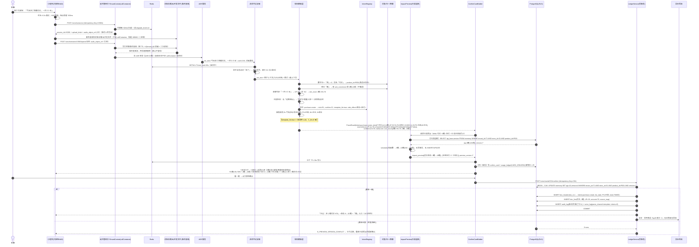

> **成本归因**：本次 `C_asr ≈ 1 次`，`C_llm = 0`（规则层命中），扣 1 次有效语音记账；若用户 30s 未按，卡片转「待确认」列表、**不落账、不重复扣次**。

### 5.3 `voice_session` 状态机

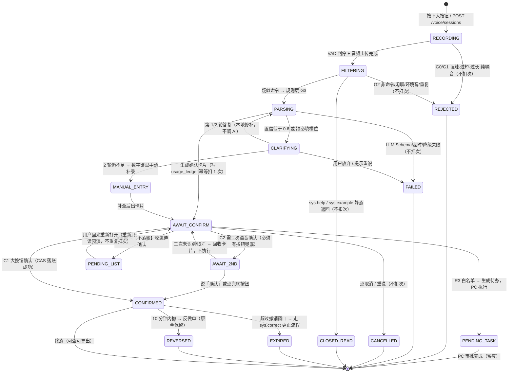

> **R0 只读分支**：`PARSING` 后若 `risk_level=R0` → 直接 `CLOSED_READ`，**不进 AWAIT_CONFIRM、不扣确认位**（H2）。**R3 分支**：`AWAIT_CONFIRM` 前即被拦截到 `PENDING_TASK`（H8）。
>
> **v1.1 补充**：**权益态（`entitlement` / `virtual_order` / `deliver_event`）与 `voice_session` 状态机相互独立**——下单、发货推送、查单兜底、额度发放走 §5.4 时序，**不进入 `voice_session` 的任何状态、不写 `usage_ledger`、不占确认卡片**；`voice_session` 仅承载语音记账链路（H1/H8/D12）。

### 5.4 虚拟支付与权益发放时序图（v1.1 新增 · 决策卡 A7/A8/A10）

```mermaid
sequenceDiagram
  autonumber
  actor U as 用户(同一小程序/大屏管理页)
  participant MP as 小程序前端
  participant VP as VirtualPaymentService
  participant XPAY as 小程序虚拟支付平台
  participant FN as 云开发云函数(xpay_* 消息推送唯一接收方)
  participant DLV as DeliverCallbackHandler
  participant ENT as EntitlementService
  participant DB as 主库(方案A外挂PG/方案B云开发)
  participant TIMER as query_order 定时兜底

  U->>MP: 点「买 30 天权益 / 语音加油包」(一次性道具直购,无自动续费)
  MP->>VP: POST /entitlement/order {goods_id}
  VP->>DB: 生成唯一 outTradeNo + 写 virtual_order(pay_status=pending)
  VP-->>MP: 返回 wx.requestVirtualPayment 参数(现网 AppKey,沙箱不得用于生产)
  MP->>XPAY: wx.requestVirtualPayment(iOS 需 IAP/微信≥8.0.68/最低1元;Windows端可购,费率需核实)
  XPAY-->>MP: 支付 success【仅展示,不作发货依据】
  MP-->>U: 「付款成功,权益发放中」(不本地加额度)

  XPAY-->>FN: 发货推送 xpay_goods_deliver_notify 等 xpay_*【唯一路径·云函数,无需独立服务器/无需域名】
  FN->>DLV: 转发发货事件
  DLV->>DLV: ① 校验签名(失败→E_PAY_SIGN_INVALID) ② 幂等键 outTradeNo
  DLV->>DB: INSERT deliver_event UNIQUE(tenant_id,out_trade_no)
  alt 重复推送(唯一冲突)
    DB-->>DLV: E_DELIVER_DUPLICATE【不重复发额度】
    DLV-->>XPAY: 发货成功(幂等返回)
  else 首次发货
    DLV->>ENT: 发放:usage_quota 加额度 / 延长 entitlement.valid_until
    ENT->>DB: UPDATE entitlement + usage_quota【不写 usage_ledger,与语音消耗分离】
    DLV->>DB: virtual_order.pay_status=paid + audit_log
    DLV-->>XPAY: 发货成功
  end

  loop 定时兜底(推送丢失/延迟)
    TIMER->>VP: POST /entitlement/query-order {outTradeNo}
    VP->>XPAY: query_order 查单
    XPAY-->>VP: 已支付但本地未发货
    VP->>DLV: 补发货(仍走验签 + deliver_event 幂等,不重复发额度)
  end
  Note over MP,XPAY: 发货只以推送为准;前端 success 不发货;不自建 notify_url 域名;重复推送不重复发额度;付费额度与语音扣次互不混算
```

> **铁律核对**（与决策卡 A10/A12 对齐）：① **发货只以「发货推送」为准**，前端 `success` 回调**只展示、不作发货依据**；② **不自建 `notify_url` 域名**——发货推送**只有一条路径**：云开发云函数消息推送（**已核实**；云托管消息推送**不作为虚拟支付发货路径，不存在第二路径**，见 Q20）；③ **签名校验 + `deliver_event UNIQUE(tenant_id, out_trade_no)` 幂等** + `query_order` 定时查单兜底，**重复推送不重复发额度**；④ 发货 = 给 `tenant_id` 的 `usage_quota` 加额度 / 延长 `entitlement` 有效期，**不写 `usage_ledger`**；⑤ **不引导外部付款**，MVP 可不放付费入口；⑥ 平台规则 2026-11-15 检索，**上线前复核**。

---

## 6. 核心类与接口设计（Data Structures and Interfaces · classDiagram）

> 完整可独立渲染版本见 `docs/class-diagram.mermaid`。

```mermaid
classDiagram
  direction LR
  class TenantContext {
    +UUID tenant_id
    +UUID store_id
    +UUID member_id
    +str role_code
    +int tenant_version
    +from_jwt(token) TenantContext
    +bind() void
    +require_store(store_id) void
    +cache_key(biz, id) str
  }
  class VoiceSession {
    +UUID session_id
    +UUID tenant_id
    +UUID store_id
    +str state
    +int clarify_round
    +datetime expires_at
    +str idempotency_key
    +create(req) VoiceSession
    +transition(to, reason) void
    +is_expired() bool
  }
  class AsrResult {
    +str text
    +float overall_conf
    +list~TokenConf~ tokens
    +slot_conf(slot_code) float
    +calibrate(table) AsrResult
  }
  class ParseResult {
    +str intent_id
    +dict slots
    +dict source
    +float confidence
    +ClarifyRequest clarify
    +str channel
    +list~CalcTrace~ calc_traces
    +validate(schema) bool
  }
  class ConfirmCard {
    +UUID card_id
    +UUID session_id
    +str asr_text
    +str intent_label_zh
    +list~SlotView~ slot_views
    +list~CalcTrace~ calc_traces
    +list~ImpactItem~ impact_preview
    +RiskBanner risk_banner
    +str primary_label
    +int preview_version
    +datetime created_at
    +build(p, preview) ConfirmCard
    +edit(slot_deltas) ConfirmCard
    +is_expired() bool
  }
  class IntentDef {
    +str intent_id
    +str domain
    +str risk_level
    +str confirm_policy
    +list~SlotDef~ slots
    +dict side_effect
    +dict reversal
    +bool template_hit
    +bool whitelist_blocked
    +dict clarifier_templates
    +list~str~ sample_utterances
  }
  class TemplateRule {
    +str template_id
    +int version
    +str intent_id
    +str pattern
    +int priority
    +dict slot_extractors
    +dict default_rules
    +dict conflict_rules
    +bool enabled
    +str review_status
    +match(text, ctx) ParseResult
  }
  class DocHeader {
    +UUID doc_id
    +UUID tenant_id
    +UUID store_id
    +str doc_no
    +str intent_id
    +str doc_type
    +date biz_date
    +str payment_status
    +int total_amount_fen
    +str status
    +UUID reversed_by
    +create(...) DocHeader
    +reverse(reason) DocHeader
  }
  class DocLine {
    +UUID line_id
    +UUID doc_id
    +UUID product_id
    +Decimal qty
    +str unit
    +int unit_price_fen
    +int amount_fen
    +dict source_map
  }
  class Inventory {
    +UUID inventory_id
    +UUID tenant_id
    +UUID store_id
    +UUID product_id
    +Decimal qty_base
    +int version
  }
  class PersonalDictEntry {
    +UUID dict_id
    +UUID tenant_id
    +UUID member_id
    +str layer
    +str raw_text
    +str mapped_type
    +UUID mapped_id
    +int version
  }
  class Reversal {
    +UUID reversal_id
    +UUID original_doc_id
    +UUID reversal_doc_id
    +UUID member_id
    +str reason
    +datetime created_at
  }
  class UsageLedger {
    +UUID ledger_id
    +UUID tenant_id
    +UUID session_id
    +str event_type
    +int cost_estimate_fen
    +record_card_created(session_id) bool
  }

  class AsrProvider {
    <<interface>>
    +transcribe(audio_ref, hotwords) AsrResult
    +supports_word_confidence() bool
    +supports_hotwords() bool
  }
  class VoiceGateService {
    +check(req) GateResult
    +vad_stop(audio) datetime
    +dedupe(fingerprint) bool
  }
  class NonCommandFilter {
    +filter(asr_text, ctx) FilterResult
    +is_static_intent(text) bool
    +is_duplicate(hash) bool
    +route_static(code) dict
  }
  class TemplateEngine {
    +match(text, ctx) ParseResult
    +resolve_conflict(text) ConflictVerdict
    +register(rule) void
  }
  class SlotFiller {
    +fill(raw_slots, intent) dict
    +apply_defaults(slots) dict
    +mark_source(slots) dict
    +validate_required(slots) ClarifyRequest
  }
  class ChineseNumberParser {
    +parse(text, context) NumberResult
    +amount_or_unit_price(text) MoneyResult
    +candidates(text) list
  }
  class AliasResolver {
    +resolve(text, ctx) list~Candidate~
    +score(c1, c2) float
    +need_disambiguation(top2) bool
  }
  class UnitConverter {
    +convert(qty, from_u, to_u, product) ConvertResult
    +has_ratio(product, unit) bool
  }
  class ConfidenceCalibrator {
    +calibrate(raw, band) float
    +proxy_confidence(text, parsed) float
    +grade(conf) str
  }
  class LlmFallbackParser {
    +parse(text, ctx, hint) ParseResult
    +build_prompt(ctx, hint) Prompt
    +validate_json(raw) ParseResult
    +retry_once(err) ParseResult
  }
  class IntentRegistry {
    +get(intent_id) IntentDef
    +all() list~IntentDef~
    +by_risk(level) list~IntentDef~
    +is_whitelisted(intent_id) bool
  }
  class ClarifyStateMachine {
    +next(state, answer) ClarifyTransition
    +max_rounds() int
    +render_question(slot, band) ClarifyQuestion
    +to_manual_entry() ManualEntry
  }
  class CorrectionFeedbackService {
    +record(event) void
    +write_hot_cache(event) void
    +spawn_candidates(event) void
  }
  class ImpactPreviewService {
    +simulate(current, delta) Projected
    +preview(parse, ctx) list~ImpactItem~
    +assert_readonly(conn) void
  }
  class ConfirmCardBuilder {
    +build(parse, preview) ConfirmCard
    +render_7_blocks(card) dict
    +primary_label(parse) str
  }
  class LedgerService {
    +confirm(card_id, ctx) DocHeader
    +cas_check(version) bool
    +apply_side_effect(delta, tx) void
    +write_audit(tx, action) void
  }
  class ReversalService {
    +reverse(doc_id, reason, ctx) Reversal
    +within_window(doc) bool
    +is_referenced(doc) bool
  }
  class QuotaService {
    +check(tenant_id) QuotaState
    +consume(tenant_id) bool
    +degrade_level(tenant_id) str
    +circuit_break(tenant_id) void
  }
  class UsageMeter {
    +on_card_created(session_id, tx) UsageLedger
    +estimate_cost(voice_log) int
    +monthly_usage(tenant_id) dict
  }
  class TenantRepository {
    <<interface>>
    +scoped_query(model) Query
    +insert(entity) void
  }
  class ExportService {
    +enqueue(scope, ctx) UUID
    +execute(job_id) str
    +forward_to_wechat(job_id) str
  }
  class AsrService {
    +transcribe(audio_ref, hotwords) AsrResult
    +with_calibration(table) AsrResult
  }
  class Entitlement {
    +UUID entitlement_id
    +UUID tenant_id
    +str plan_code
    +datetime valid_from
    +datetime valid_until
    +int quota_granted
    +str status
    +is_active() bool
    +extend(days) Entitlement
  }
  class VirtualOrder {
    +UUID order_id
    +UUID tenant_id
    +str out_trade_no
    +str goods_id
    +str pay_status
    +str env
    +create_order(goods_id) VirtualOrder
  }
  class DeliverEvent {
    +UUID event_id
    +UUID tenant_id
    +str out_trade_no
    +str event_type
    +str sign_status
    +str deliver_status
    +is_duplicate() bool
  }
  class VirtualPaymentService {
    +create_order(goods_id, ctx) dict
    +build_pay_params(order) dict
    +query_order(out_trade_no) dict
    +goods() list
  }
  class EntitlementService {
    +current(tenant_id) Entitlement
    +grant_quota(tenant_id, amount) void
    +extend_validity(tenant_id, days) void
  }
  class DeliverCallbackHandler {
    +handle(payload) str
    +verify_sign(payload) bool
    +dedupe(out_trade_no) bool
    +apply_delivery(event) void
  }
  class UploadTicketService {
    +issue(session_id, content_type) dict
    +assert_100k(req) void
    +resolve(ref) str
    +revoke(ref) void
  }

  VoiceSession "1" --> "0..1" ConfirmCard : 生成
  VoiceSession "1" --> "1" AsrResult : 转录
  AsrResult "1" --> "0..1" ParseResult : 解析
  ParseResult "1" --> "0..1" ConfirmCard : 构建
  ConfirmCard "1" --> "0..1" DocHeader : 确认落账
  DocHeader "1" *-- "1..*" DocLine : 明细
  DocHeader "1" --> "0..1" Reversal : 反做(不删原单)
  DocHeader ..> Inventory : 影响(库存)
  VoiceSession "1" --> "0..1" UsageLedger : 幂等计费
  TenantContext ..> TenantRepository : 注入 tenant_id
  IntentRegistry "1" o-- "38" IntentDef : 注册
  TemplateRule ..> IntentDef : 映射 intent_id
  TemplateEngine "1" o-- "*" TemplateRule : 优先级链
  TemplateEngine ..> SlotFiller : 填充
  TemplateEngine ..> ChineseNumberParser : 归一
  TemplateEngine ..> AliasResolver : 实体
  TemplateEngine ..> UnitConverter : 换算
  LlmFallbackParser ..> IntentRegistry : 读 schema
  LlmFallbackParser ..> PersonalDictEntry : 注入预算
  VoiceGateService ..> NonCommandFilter : 前置
  NonCommandFilter ..> TemplateEngine : 放行
  NonCommandFilter ..> LlmFallbackParser : 静态意图短路
  TemplateEngine ..> LlmFallbackParser : 未命中升级
  LlmFallbackParser ..> ClarifyStateMachine : 低置信
  ClarifyStateMachine ..> ConfirmCardBuilder : 通过
  ConfirmCardBuilder ..> ImpactPreviewService : 只读预演
  ImpactPreviewService ..> Inventory : 只读当前态
  LedgerService ..> ConfirmCard : CAS 校验
  LedgerService ..> ReversalService : 撤销委托
  CorrectionFeedbackService ..> PersonalDictEntry : 即时生效
  CorrectionFeedbackService ..> TemplateRule : 候选模板(审核后)
  QuotaService ..> UsageMeter : 配额/成本
  AsrProvider <|.. AsrService : 实现
  AsrService ..> AsrResult : 产出置信度
  VoiceGateService ..> AsrService : 调用转录
  ConfidenceCalibrator ..> AsrResult : 校准
  ExportService ..> TenantContext : 强制租户
  ExportService ..> LedgerService : 大屏管理页导出(仅老板+二次确认)
  VirtualPaymentService ..> VirtualOrder : 下单(生成 outTradeNo)
  VirtualPaymentService ..> Entitlement : 读当前权益
  VirtualOrder "1" --> "0..1" DeliverEvent : 发货推送(幂等)
  DeliverCallbackHandler ..> DeliverEvent : 验签+去重
  DeliverCallbackHandler ..> EntitlementService : 委托发放
  EntitlementService ..> Entitlement : 延长 valid_until
  EntitlementService ..> UsageLedger : 只发额度不写扣次(分离)
  UploadTicketService ..> VoiceSession : 签发临时引用
  UploadTicketService ..> AsrProvider : 凭 audio_object_ref 取音频
  VirtualPaymentService ..> DeliverCallbackHandler : query_order 兜底补发货
```

> **关系说明**：`ConfirmCard → DocHeader` 是**唯一**写库转换点；`ImpactPreviewService` 与 `Inventory` 之间只存在**只读**依赖（图中以 `..>` 标注，不产生写）。`DocHeader *-- DocLine` 为组合（同生共死，反做时整单反做）。**v1.1 新增**：`VirtualPaymentService / EntitlementService / DeliverCallbackHandler / UploadTicketService` 与 `Entitlement / VirtualOrder / DeliverEvent` 构成**权益发放链**，与语音记账链（`voice_session`）**相互独立**；发货只以推送为准、重复推送经 `DeliverEvent` 去重；`ExportService.forward_to_wechat()` 面向**电脑版微信大屏管理页**（导出文件不网页下载）。

## 7. 程序调用流（Program Call Flow · CRUD / 初始化）

> 完整可独立渲染版本见 `docs/sequence-diagram.mermaid`（为 §5.2 主链路）。

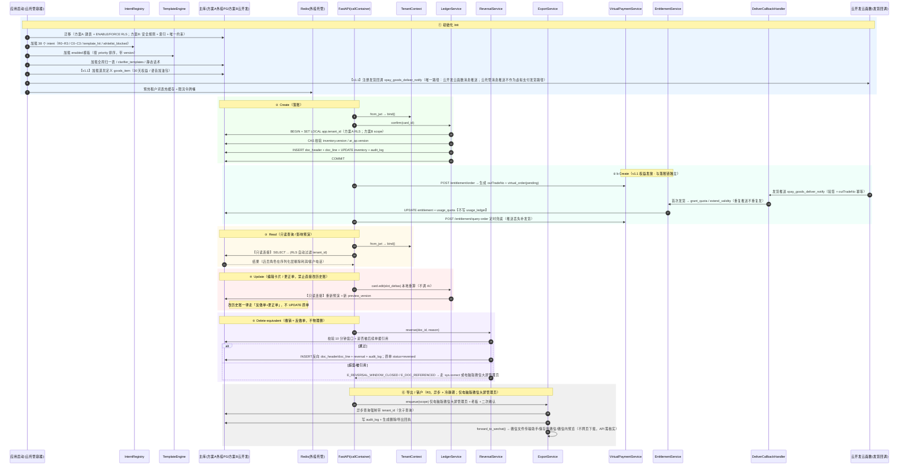

---

# Part B · Task Decomposition

## 8. 任务分解

### 8.1 Required Packages（依赖包清单）

> 版本均为建议，实际以 T01 锁定的 lockfile 为准；标注「需核实」的为外部服务 SDK/能力。

**端侧（微信小程序 / `miniprogram/` · 手机端 + 电脑版微信大屏同一份代码）**

```
- typescript@^5.4: 小程序 TS 工程
- miniprogram-api-typings@^3: 微信 API 类型声明
- 微信原生 RecorderManager / VAD（平台端点检测能力需核实；电脑版微信端麦克风可用性需核实）
- 【v1.1】app.json 配 resizable + 大屏适配组件 large-screen/*（双栏管理页：档案/说法训练/单据更正/报表/用量套餐/权限/R3 待办审批/导出）
- 【v1.1】微信文件转发 / 保存到微信 / 微信内预览 API（导出交付；**API 需核实**，Q23）
- 【v1.1】wx.requestVirtualPayment（小程序虚拟支付，二级商户号道具直购；Windows 端可购，费率口径需核实）
- 【v1.1】wx.cloud.uploadFile / wx.cloud.*（音频临时直传，仅传 audio_object_ref；**不需配服务器合法域名**——`wx.uploadFile` 才需配，本设计禁用）
- 自研 utils: audio-gate / num-keyboard / card-render / large-screen（无第三方重依赖，控制包体积）
```

> **【v1.1 删除】** 原「独立网页管理端（`/web/`）」整段前端框架工程依赖（构建工具 / UI 框架 / 组件库 / 原子样式 / 路由 / 状态管理 / HTTP / 校验 / 图表 / 导出库等，共 10 类）——**不做独立网页版 / 不做 H5 / 不引入独立前端框架工程**（决策卡 A1/H23）；原管理端职责由**同一小程序的电脑版微信大屏管理页**承接。

**服务端（`/server/` · 微信云托管容器）**

```
- python@^3.11 / fastapi@^0.110 / uvicorn[standard]@^0.29: 容器内 HTTP 服务（经 callContainer 私有协议暴露）
- pydantic@^2: LLM 输出 JSON Schema 强校验、DTO
- sqlalchemy@^2 + alembic@^1.13 + psycopg[binary]@^3: ORM / 迁移 / PostgreSQL RLS（**外挂托管 PostgreSQL，能力/延迟/成本需核实**，方案 A；方案 B 改云开发数据库 SDK）
- redis@^5 (asyncio): 令牌桶 Lua / 去重 / 卡片 TTL / 词表热缓存（**外挂托管 Redis，能力/延迟/成本需核实**）
- pyahocorasick@^2 (或等效 AC 自动机): 词表与业务动词最长匹配
- pypinyin@^0.5: 别名拼音相似召回
- python-jose / PyJWT@^2: JWT（含 tenant_id / role / tenant_version）
- tenacity@^8: LLM 重试（最多 1 次）与超时
- structlog@^24: 结构化日志（含 tenant_id / session_id / 成本归因）
- ASR SDK / LLM SDK: 供应商适配器（型号与价格需核实，禁止写死）
- 【v1.1】微信云托管 SDK / callContainer 适配（私有链路、100KiB 断言、免服务器域名配置）
- 【v1.1】小程序虚拟支付 SDK（下单签名 / query_order 查单 / 发货推送验签；现网 AppKey，沙箱不得用于生产）
- 【v1.1】云开发云函数 SDK（xpay_* 消息推送**唯一接收方**：xpay_goods_deliver_notify / xpay_refund_notify / xpay_complaint_notify / xpay_subscribe_*；云托管消息推送**不作为虚拟支付发货路径**）
- 【v1.1】对象存储 / 云开发文件 SDK（临时上传凭证 upload_ticket、audio_object_ref、限期删除；容器不持久化）
- pytest@^8 + pytest-asyncio + testcontainers: 双租户越权测试 / RLS 校验 / 发货幂等 / 100KiB 断言 / 方案 B 隔离替代
```

**基础设施 / 工程化**

```
- 【v1.1】微信云托管环境 + 服务（callContainer 私有协议；免域名 / 免 ICP 域名备案 / 免 HTTPS 证书 / 免配服务器域名；默认公网域名仅供接口测试，不能用于生产）
- 【v1.1】云开发云函数（`xpay_*` 消息推送**唯一接收方**；云托管消息推送不作为虚拟支付发货路径）
- 【v1.1】外挂托管 PostgreSQL / Redis 或云开发数据库（云托管内不部署有状态服务，§4.5；能力/延迟/成本需核实）
- 【v1.1】对象存储 / 云开发文件（临时音频 / 导出文件 / 删除回执；容器不持久化，音频默认不留存）
- 轻量任务队列（导出/报表/回流/销户）
- Docker + docker-compose: **仅本地容器构建与联调**（生产由微信云托管托管，不自建服务器）
- GitHub Actions / 等效 CI: lint + 静态扫描（无 tenant_id 检测）+ 单测 + 双租户越权用例
- 结构化日志 + 指标 + 告警（成本/命中率/配额，§2.4.6）
- 【v1.1】小程序备案（AppID 备案，T01 并行启动）+ 虚拟支付开通/二级商户号/道具配置/iOS IAP（**时长与费率需核实**）
```

### 8.2 文件列表（分层目录树）

```
voice_inventory_lite/
├─ docs/
│  ├─ 01-PRD.md                         # 需求基线（已交付）
│  ├─ 02-架构设计.md                     # 本文
│  ├─ class-diagram.mermaid             # 类图（独立文件）
│  └─ sequence-diagram.mermaid          # 核心时序图（独立文件）
├─ miniprogram/                         # 微信小程序（同一 AppID：手机端主录入 + 电脑版微信大屏管理页）
│  ├─ app.ts / app.json（resizable:true）/ app.wxss / project.config.json
│  ├─ pages/voice/index.{ts,wxml,wxss,json}        # 语音大按钮 + 录音门禁
│  ├─ pages/card/index.{ts,wxml,wxss,json}         # 7 区块确认卡片
│  ├─ pages/pending/index.*                        # 待确认列表
│  ├─ pages/query/index.*                          # 只读查询
│  ├─ pages/pay/index.*                            # 【v1.1】虚拟支付道具直购（MVP 可不放入口）
│  ├─ pages/admin/*                                # 【v1.1】大屏管理页：档案/单据更正/报表/用量套餐/权限/说法训练/R3 待办审批/导出
│  ├─ components/big-button/ · slot-table/ · impact-preview/ · num-keyboard/ · candidate-picker/
│  ├─ components/large-screen/*                    # 【v1.1】双栏适配 / 大屏表格 / 审批面板 / 导出转发组件
│  ├─ services/api.ts · audio-gate.ts · upload.ts · idempotency.ts · virtual-pay.ts · wx-file-forward.ts
│  └─ utils/vad.ts · dedupe.ts · format.ts
├─ server/                              # 微信云托管容器（callContainer 私有协议）
│  ├─ pyproject.toml / alembic.ini / Dockerfile（仅本地容器构建）/ requirements.lock
│  ├─ app/main.py / app/deps.py / app/config.py
│  ├─ app/tenant/{context.py, rls.py, repository.py, cache.py, guards.py}     # ★多租户基座（方案B 时 rls.py 换安全规则 + 强制 scope）
│  ├─ app/api/v1/{auth,voice,cards,clarify,confirm,reversal,query,usage,dict,exports,tasks,account,entitlement,upload}.py
│  ├─ app/pay/*                                    # 【v1.1】虚拟支付：virtual_payment.py / deliver_callback.py / goods_item.py / sign.py
│  ├─ app/services/{entitlement.py, upload_ticket.py}   # 【v1.1】权益发放 / 音频临时上传凭证
│  ├─ app/models/{entitlement.py, virtual_order.py, deliver_event.py, goods_item.py}  # 【v1.1】支付权益模型
│  ├─ app/voice/{gate.py, non_command_filter.py, asr_provider.py, asr_calibration.py}
│  ├─ app/voice/{template_engine.py, template_rule.py, conflict_detector.py, slot_filler.py}
│  ├─ app/voice/{number_normalizer.py, alias_resolver.py, unit_converter.py, amount_calculator.py}
│  ├─ app/voice/{llm_fallback.py, prompt_builder.py, output_schema.py, prompt_cache.py}
│  ├─ app/voice/{confidence.py, clarify_fsm.py, clarifier_templates.py}
│  ├─ app/voice/{card_builder.py, impact_preview.py, source_tags.py}
│  ├─ app/domain/{intent_registry.py, intent_def.py, schemas/intents.json, slots.json, clarifiers.json}
│  ├─ app/domain/{doc_service.py, inventory_service.py, ar_ap_service.py, report_service.py}
│  ├─ app/services/{ledger.py, reversal.py, audit.py, pending_task.py}
│  ├─ app/services/{quota.py, usage_meter.py, degrade.py, cost_monitor.py}
│  ├─ app/services/{correction_feedback.py, dict_layers.py, template_candidate.py}
│  ├─ app/services/{export_job.py, deletion_request.py}
│  ├─ app/models/*.py（tenant/store/member/role/product/alias/conversion/partner/inventory/doc/ar_ap/payment/voice/card/usage/dict/reversal/pending/audit/export/deletion）
│  ├─ app/schemas/*.py（Pydantic DTO，含 parse_result / confirm_card / api_envelope）
│  ├─ migrations/versions/*.py（建表 + RLS + 索引 + 唯一约束 + 种子 intent/模板/归一表）
│  └─ tests/{test_rls_cross_tenant.py, test_template_hit.py, test_conflict_snapshot_vs_increment.py, test_impact_preview_readonly.py, test_quota_idempotency.py, test_clarify_rounds.py, test_reversal.py}
├─ packages/shared/                     # 端/服共享契约（TS 与 Python 各生成一份）
│  ├─ contracts/{api-envelope.ts, intents.json, slots.json, error-codes.json, source-enum.json, goods.json}  # 【v1.1】goods.json 道具定义
│  ├─ schemas/{parse-result.schema.json, confirm-card.schema.json, voice-session.schema.json, entitlement.schema.json}  # 【v1.1】权益 schema
│  └─ utils/{money.ts, date.ts, unit.ts}（金额分 / ISO 8601 / 单位归一双端对齐）
├─ cloudfunctions/                      # 【v1.1】云开发云函数（xpay_* 消息推送唯一接收方；云托管消息推送不作为虚拟支付发货路径）
│  └─ xpay_deliver_notify/index.js（xpay_goods_deliver_notify → 验签 + outTradeNo 幂等 → 加额度/延期）
└─ infra/
   ├─ docker-compose.yml（仅本地容器构建）/ .env.example
   ├─ cloudhosting/{service.yaml, container.config.json}  # 【v1.1】云托管服务/容器配置（免服务器域名配置）
   ├─ ci/{lint.yml, tenant-guard-scan.py, test.yml}
   └─ observability/{metrics.yaml, alerts.yaml}
```

### 8.3 Task List（≤5 个任务，按依赖排序）

> 分组原则：按层次/功能模块分组，每任务 ≥3 个文件；除 T01 外尽量只依赖 T01，避免过度线性链。

| Task ID | 模块 / 任务名 | 产出文件（相对路径） | 依赖 | 优先级 | 验收标准 |
|---|---|---|---|---|---|
| **T01** | **项目基础设施 + 共享契约 + 云托管/云函数/备案并行启动** | `miniprogram/app.ts`、`app.json`（`resizable:true`）、`project.config.json`；`server/pyproject.toml`、`app/main.py`、`app/config.py`、`Dockerfile`（仅本地容器构建）；`infra/cloudhosting/{service.yaml,container.config.json}`（**微信云托管环境与服务**）、`cloudfunctions/xpay_deliver_notify/index.js`（**云开发云函数**）、`server/app/services/upload_ticket.py`（**对象存储临时上传凭证**）；`packages/shared/contracts/*`（`api-envelope.ts` / `intents.json` / `slots.json` / `error-codes.json` / `source-enum.json` / **`goods.json` 道具定义**）、`packages/shared/schemas/*`（含 **`entitlement.schema.json` 权益 / `deliver_event` 发货 schema**）、`packages/shared/utils/*`；`infra/docker-compose.yml`、`.env.example`；`docs/class-diagram.mermaid`、`docs/sequence-diagram.mermaid`；**【并行·非代码】小程序备案（AppID 备案）时间线 T01 启动**：主体注册 → 微信认证 → 平台初审 1-2 工作日 → 短信核验 24h → 管局 1-20 工作日（不加急）；同步开虚拟支付二级商户号 + 道具 + iOS IAP（**时长需核实**） | — | **P0** | ① **微信云托管 `callContainer` 连通 + 免服务器域名配置**（小程序经私有协议调通容器健康检查，无需配 `request`/`uploadFile`/`downloadFile` 合法域名、无域名/ICP 备案/HTTPS 证书）；② 小程序（手机端 + 电脑版微信大屏同一份代码）与云托管容器均可本地启动并互相调用；③ 38 个 intent 常量、18 槽位、`source` 枚举、错误码表、**权益/道具/发货契约**在端/服**单一真相源**；④ API 统一包络 `{code,data,message}` 与幂等键拦截器生效；⑤ 金额/日期/单位归一工具端服结果一致；⑥ CI 骨架可跑；⑦ **小程序备案已提交并留存时间线凭证**（不阻塞开发，上线/开支付前必须完成） |
| **T02** | **数据层 + 多租户基座 + 云托管数据层方案落地 + 权益模型**（H16/H17） | `server/app/tenant/{context.py,rls.py,repository.py,cache.py,guards.py}`（方案 B 时 `rls.py` → 安全规则 + 强制 scope）；`server/app/models/*.py`（**34 张表**，按 §4.3.2 清单全量，含 **`entitlement.py`/`virtual_order.py`/`deliver_event.py`/`goods_item.py`**，含 `UNIQUE(tenant_id,out_trade_no)` 去重约束）；`server/migrations/versions/*.py`（方案 A 建表 + `ENABLE/FORCE RLS` + 索引 + 唯一约束 + intent/模板/归一表/**道具**种子）；`server/app/api/v1/auth.py`；`server/tests/{test_rls_cross_tenant.py,test_tenant_scope_no_rls.py}`；`infra/ci/tenant-guard-scan.py` | T01 | **P0** | ① **数据层方案 A/B 决策落地**（§4.5）：方案 A 外挂托管 PG 所有业务表启用并 FORCE RLS、应用账号非 BYPASSRLS；方案 B 云开发数据库以「安全规则 + `TenantRepository` 强制 scope」替代并**如实标注隔离强度下降**；② 微信登录链路（`openid/unionid → tenant_id`）签发含 `tenant_id/store_id/role/tenant_version` 的 JWT，请求级 contextvar 注入；③ ORM 全局 scope 自动追加/填充 `tenant_id`，缓存 key 强制 `t:{tenant_id}:` 前缀；④ CI 静态扫描能拦下「无 tenant_id 的 SQL」；⑤ **双租户越权单测全绿**（A 查 B 为空 / 越权写抛错 / 导出不含跨租户）；⑥ **方案 B 无 RLS 时的隔离替代测试全绿**（五件套：安全规则 / 强制 scope / 唯一索引 tenant_id 打头 / CI 扫描 / 双租户越权）；⑦ 权益/订单/发货事件表与去重约束生效；⑧ 商品与客户供应商为租户级、库存单据门店级、个人词表员工级；⑨ 新增门店无需迁移数据、历史 `doc_no` 不变 |
| **T03** | **语音解析流水线 + 成本护栏 + 音频临时直传 + 发货回调**（核心，H3/H4/H11/H12/H13） | `server/app/voice/` 全目录（`gate.py`、`non_command_filter.py`、`asr_provider.py`、`asr_calibration.py`、`template_engine.py`、`template_rule.py`、`conflict_detector.py`、`slot_filler.py`、`number_normalizer.py`、`alias_resolver.py`、`unit_converter.py`、`amount_calculator.py`、`llm_fallback.py`、`prompt_builder.py`、`output_schema.py`、`prompt_cache.py`、`confidence.py`、`clarify_fsm.py`、`clarifier_templates.py`）；`server/app/domain/intent_registry.py` + `schemas/*.json`；`server/app/services/{quota.py,usage_meter.py,degrade.py,cost_monitor.py,upload_ticket.py}`；`server/app/pay/deliver_callback.py`（**发货推送验签 + `deliver_event` 幂等**）；`server/tests/{test_template_hit.py,test_conflict_snapshot_vs_increment.py,test_quota_idempotency.py,test_clarify_rounds.py,test_audio_100k.py,test_deliver_idempotency.py}` | T01, T02 | **P0** | ① 六层漏斗可跑通，端侧门禁阈值 0.8s/15s(硬20s)/VAD/300ms 生效；② **音频走对象存储/云开发文件临时上传（不以二进制/base64 进 `callContainer`）**，仅传 `audio_object_ref` 引用、100KiB 断言、临时对象限期删除、音频默认不留存（D11）；③ 18 个 `template_hit` intent 标准句式 **100% 不调 LLM**；④ 12 类冲突回归集全过，尤其「还剩 8 箱=快照」vs「再入 8 箱=增量」不得判反、无换算系数不得臆造；⑤ LLM 输出紧凑 JSON + `source` 五枚举 + Schema 强校验 + 最多 1 次重试 + 超时降级；⑥ 注入预算仅 Top20+个人词表+最近 3 上下文，**静态意图不调 LLM**；⑦ 澄清硬上限 2 轮、一次 1 槽、话术配置化；⑧ 租户级令牌桶 30/min、1000/day、60s 去重、`usage_ledger` 唯一约束幂等、**仅卡片生成成功扣次**（与付费发放分离）；⑨ 超额/异常自动降级 L2~L4 且历史可查可导出；⑩ 成本/命中率/缓存命中率指标可观测；⑪ **发货推送单路径落地**：云开发云函数消息推送接收 `xpay_*`（**已核实为唯一路径**；云托管消息推送**不作为虚拟支付发货路径**），验签 + `OutTradeNo` 幂等 + `query_order` 查单兜底，**不丢发货、不重复发额度**（Q20） |
| **T04** | **确认卡片 + 写账业务服务 + 虚拟支付/权益发放 + API 全集**（H1/H8/H9/H10） | `server/app/voice/{card_builder.py,impact_preview.py,source_tags.py}`；`server/app/domain/{doc_service.py,inventory_service.py,ar_ap_service.py,report_service.py}`；`server/app/services/{ledger.py,reversal.py,audit.py,pending_task.py,correction_feedback.py,dict_layers.py,export_job.py,deletion_request.py,entitlement.py,upload_ticket.py}`；`server/app/pay/{virtual_payment.py,deliver_callback.py,goods_item.py,sign.py}`（**下单 / 发货 / 查单 / 权益发放**）；`server/app/api/v1/{voice,cards,clarify,confirm,reversal,query,usage,dict,exports,tasks,account,entitlement,upload}.py`；`server/tests/{test_impact_preview_readonly.py,test_reversal.py,test_deliver_idempotency.py,test_entitlement_separation.py}` | T01, T02, T03 | **P0** | ① 卡片 7 区块齐全，缺省/换算/别名/待确认均有 `source` 角标与计算式；② **影响预演走只读连接且 `simulate` 无副作用**，落账 CAS 校验版本，冲突返回 `E_PREVIEW_VERSION_CONFLICT`；③ 任何写操作必经确认卡片，R0 只读不占卡片不写库，R3 仅生成 `pending_task` 且**仅电脑版微信大屏管理页**（同一 JWT + `role=boss` + 二次确认）才能执行；④ C2 二次语音**有按钮兜底**、禁止超时自动执行；30s 超时不落账入待确认且不重复扣次；⑤ 撤销=反做单（原单保留）、10 分钟窗口、被引用拒绝、全写操作留 `audit_log`；⑥ 卡片编辑本地重算、**不重调 AI** 并产生 `correction_event` 即时回流（Redis+DB 双写、`dict_version` 击穿缓存）；⑦ **虚拟支付下单 / 发货推送 / `query_order` 查单兜底 / 权益发放全链路可用**：**发货只以推送为准、前端 `success` 不发货**；**重复推送幂等不重复发额度**；**权益发放与语音扣次分离**（不写 `usage_ledger`）；⑧ **R3 大屏审批 + 导出经微信转发/保存/预览**（不网页下载）；⑨ API 清单 24 项可用，幂等键全覆盖（新增 5 个错误码生效）；⑩ `voice_session` 状态机 8+ 状态与失败分支符合 §5.3，且**权益态与语音状态机相互独立** |
| **T05** | **双端 UI（同一小程序：手机端 + 电脑版微信大屏管理页）+ 集成联调** | `miniprogram/pages/{voice,card,pending,query,pay}/index.*`、`miniprogram/pages/admin/*`（档案/单据更正/报表/用量套餐/权限/说法训练/R3 待办审批/导出）、`miniprogram/components/{big-button,slot-table,impact-preview,num-keyboard,candidate-picker}/*`、`miniprogram/components/large-screen/*`（**双栏适配**）、`miniprogram/services/{api.ts,audio-gate.ts,upload.ts,idempotency.ts,virtual-pay.ts,wx-file-forward.ts}`、`miniprogram/utils/{vad.ts,dedupe.ts,format.ts}`；`infra/observability/{metrics.yaml,alerts.yaml}`；端到端联调脚本 | T01, T04 | **P0** | ① 小程序语音大按钮拇指热区 ≥88×88px【PRD 3.2 假设】、确认主按钮带关键值文案、卡片一屏可见槽位表+金额+影响预览+按钮；② 数字键盘/常用商品点选**全程可脱离语音**完成记账；③ **电脑版微信大屏双栏适配**（`resizable`）：档案、单据列表与更正单、3 张报表、用量与套餐、权限、导出、R3 待办审批、说法训练审核；④ **导出文件转发到微信文件传输助手 / 保存到微信 / 微信内预览**（不网页下载，API 需核实）；⑤ **付费入口在小程序内**（Windows 端电脑版微信可购）、**无独立网页版 / 无账号密码**（同一 AppID + 微信登录态）；⑥ **电脑版微信里完成一次 R3 审批与一次购买**；**手机端与电脑端同账号实时同步**（小程序落账大屏立即可见）；⑦ 「进了两箱可乐，一件三十五」端到端 ≤8s【假设需压测】且库存 8→10 箱正确、`C_llm=0`；⑧ 降级态与告警面板可演示；⑨ UI **仅暴露单商户**，不出现门店/组织概念 |

### 8.4 Shared Knowledge（跨文件约定，Engineer 必读）

| 约定 | 内容 |
|---|---|
| **API 响应包络** | 统一 `{code: int, data: any, message: str}`；`code=0` 成功；前端 axios 拦截器统一解包与错误处理 |
| **鉴权** | JWT 携带 `tenant_id / store_id / member_id / role_code / tenant_version`；**业务入参禁止传 tenant_id**（一律由 `TenantContext` 注入，防伪造） |
| **租户上下文传递** | 请求级 `contextvar`；**异步队列 / 定时任务 / 导出 Job / 缓存 key / 对象存储路径 / 日志字段**必须显式带 `tenant_id`，缺失即抛异常；缓存 key 格式 `t:{tenant_id}:{store_id}:{biz}:{id}` |
| **intent 常量** | 38 个 `intent_id`（`purchase.create` … `sys.teach`）为**单一真相源**：`packages/shared/contracts/intents.json` + `server/app/domain/schemas/intents.json` 同步生成；`risk_level / confirm_policy / template_hit / whitelist_blocked / clarifier_templates / side_effect / reversal` **只在 registry 定义**，模板层与 LLM 层只读不重写 |
| **槽位与 source** | 18 槽位代号 `P/Q/U/UP/TA/C/S/D/N/PS/W/AMT/DOC/TF/TV/EF/ALIAS/RATIO`；**`CTX`（上下文继承）是内部标记不是槽位**（`slots.json.internal_markers`，`is_slot:false`，不进 ASR 解析输出），故口诀「18 槽位」成立、`/healthz` 报 `slots:18`；`source ∈ {asr, default, computed, alias, pending}`；**任何非 `asr` 值必须在卡片带角标**，`computed` 必须附 `calc_trace`，`pending` 不得静默填值 |
| **金额** | **一律以「分」为整数存储与传输**（`*_fen`），展示层格式化；计算式随卡片返回；禁止浮点直接比较 |
| **时间** | 存储 ISO 8601 UTC；展示按租户时区（`Asia/Shanghai`，**需核实**）转本地；相对时间「今天/昨天/上次」**必须解析为具体日期**并回显；跨月/跨年边界提示确认 |
| **单位归一** | 一律折算到商品 `base_unit` 并**双显**「原话 2 箱 + = 48 瓶」；`RATIO` 只来自 `unit_conversion` 且需审核，**代码禁止臆造系数**；无系数 → `pending` + 待教学队列 |
| **幂等** | 所有写接口要求 `Idempotency-Key`；写账用 `card_id`，撤销用 `doc_id+member_id`，计费用 `session_id+event_type`；网关 `SETNX` + DB 唯一约束双保险 |
| **写操作唯一入口** | `POST /voice/cards/{id}/confirm`；**任何服务不得绕过 ConfirmCard 直接写业务表**；R0 走只读连接；R3 只写 `pending_task` |
| **LLM 输出** | 强制紧凑 JSON，字段 `intent/slots/source/confidence/clarify`；禁解释文字；`max_tokens` 硬上限；Schema 校验失败最多 1 次重试 |
| **错误码** | `E_*` 常量集中 `error-codes.json`；门禁/过滤类不扣次；`E_PREVIEW_VERSION_CONFLICT` 必须触发重新预演；`E_R3_BLOCKED` 引导**电脑版微信大屏管理页**；**v1.1 新增** `E_PAY_SIGN_INVALID` / `E_DELIVER_DUPLICATE` / `E_ENTITLEMENT_EXPIRED` / `E_AUDIO_TOO_LARGE` / `E_R3_PC_REQUIRED` |
| **留痕** | 所有写操作写 `audit_log(tenant_id, member_id, action, entity, ip, at)`；`voice_log` 记录 `parse_channel / tokens_in / tokens_out / asr_text`（**不存音频**） |
| **成本标注** | 代码注释与文档中所有成本/延迟/阈值必须带 `【假设，需核实】`；**禁止出现真实厂商型号与价格** |
| **测试基线** | 每个涉及数据的改动必须过：RLS 双租户越权用例、模板命中率回归集、快照 vs 增量冲突集、影响预演只读断言、计费幂等用例、**方案 B 无 RLS 时的隔离替代测试**、**发货幂等 / 100KiB 断言** |
| **权益 / 道具常量（v1.1）** | 道具定义 `goods.json`（`goods_id` / `goods_type ∈ entitlement,quota_pack` / `price_fen` / `quota_amount` / `validity_days`）与 `entitlement.schema.json` 为端/服**单一真相源**；`plan_code ∈ free,30day,quota_pack`；**无自动续费**（`auto_renew=false`），到期提醒靠自有推送；价格/最低 1 元/费率**均需核实** |
| **发货幂等键 `outTradeNo`（v1.1）** | 下单生成唯一 `outTradeNo` → `virtual_order`；发货推送 / `query_order` 兜底统一以 `outTradeNo` 为幂等键，`deliver_event UNIQUE(tenant_id, out_trade_no)` 去重 → **重复推送不重复发额度**；**发货只以推送为准，前端 `success` 不作发货依据**；发货动作 = 加 `usage_quota` 额度 / 延长 `entitlement.valid_until`，**不写 `usage_ledger`**（A10/D12/D13） |
| **计费双口径（v1.1 · 前台不得混用）** | `usage_quota.period = YYYY-MM` **只用于自然月用量归集与成本归因**；`entitlement` 的 **30 天滚动窗口**用于**权益有效期与额度消耗计数**（购买即起算、到期即失效）。两者**分别存储、分别展示**：用量页显示「本月已用 / 本月额度」（自然月），权益卡显示「本周期剩余 N 天 / 剩余 X 次」（滚动窗口），**不得把两个口径拼进同一个进度条或同一句文案**；滚动窗口实现细节（起算点、跨月叠加、加油包是否顺延）**需核实**；**表结构不因此改动**，仅在服务层与文案层区分 |
| **音频只传引用（v1.1）** | `callContainer` 请求体**文本 100KiB 硬限制**（二进制另有 20MiB 口径、超时 15s/60s 两处官方口径**需核实**）→ **音频本体不进请求体**；端侧用 **`wx.cloud.uploadFile` / `wx.cloud.*` 直传**对象存储/云开发文件（**不需配服务器合法域名**，已核实；`wx.uploadFile` 才需配、**本设计禁用**），服务端仅接 `audio_object_ref`（临时 fileID）；`upload_ticket` 短 TTL + `t/{tenant_id}/` 路径 + 二次鉴权 + 用后限期删除（生命周期细节见 Q19） |
| **平台规则改动需复核（v1.1）** | 虚拟支付准入 / 费率 / 备案时长 / `callContainer` 体积与超时口径（文本 100KiB / 二进制 20MiB / 15s vs 60s）/ Windows 端费率 / 电脑版微信 API 差异 / Mac 基础库限制，均为 **2026-11-15 检索结论，平台规则会变，上线前须逐条复核**（速览 §4/§5）；不得把「需核实」写成事实。已核实项：`xpay_*` 发货事件**只走云开发云函数消息推送**（云托管消息推送不作为该路径）；`wx.cloud.uploadFile` / `wx.cloud.*` **不需配服务器合法域名** |
| **端与鉴权（v1.1）** | **同一 AppID、同一入口**；`wx.login` openid/unionid → `tenant_id`，**不做账号密码**；手机端与电脑版微信大屏管理页**共用同一 JWT 与同一套 API**，R3 动作额外 `role=boss` + 二次确认；隔离靠登录态 + `tenant_id` + RLS 或安全规则，**绝不「一客户一域名」** |

### 8.5 Task Dependency Graph

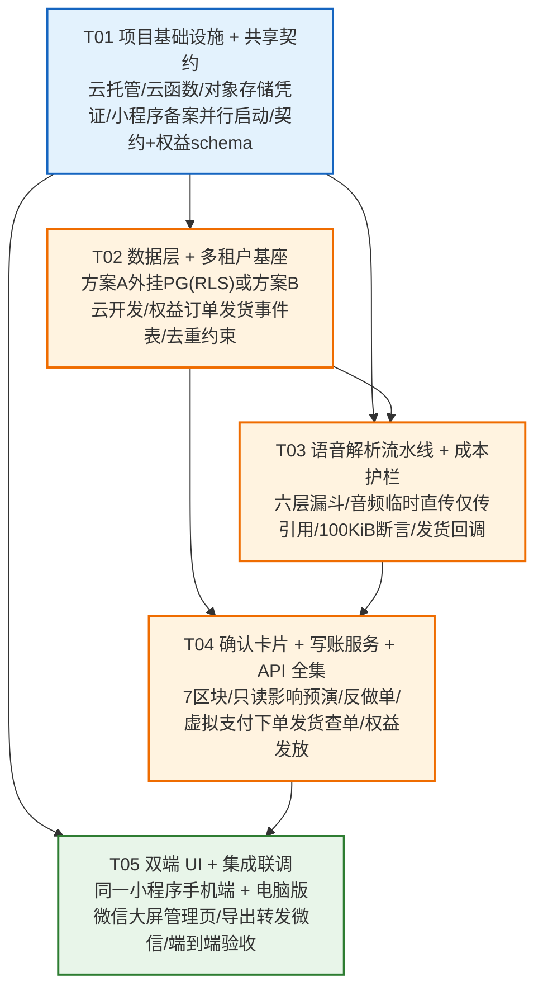

> 说明：T05 的 UI 骨架与 T01 的入口文件同批建立（只依赖 T01 即可开工），**但不做端到端联调**，联调在 T04 完成后进行；T03 与 T04 的共享契约（`ParseResult` / `ConfirmCard` Schema）在 T01 已冻结，故二者可并行开发、按契约集成。

### 8.6 里程碑与技术债 / 预留点

| 阶段 | 交付范围 | 主动承担的技术债 | 必须预留的扩展点（不实现但接口/字段先在） |
|---|---|---|---|
| **MVP（T01~T05）** | 单商户单主仓、8 域 + 系统辅助、17~20 P0 intent、六层漏斗、确认闭环、反做单、成本护栏、**微信云托管 `callContainer` + 外挂托管 PG(RLS) 或云开发数据库多租户模型 + 音频临时直传仅传引用 + 小程序虚拟支付（一次性购 30 天权益/加油包，MVP 可不放付费入口）+ 电脑版微信大屏管理页（同一小程序）+ 小程序备案并行启动** | ① 云托管容器无状态（冷启动靠最低实例，成本**需核实**）② 模板靠人工维护，learned 模板需审核 ③ 别名匹配仅字面/拼音/编辑距离 ④ 无行业词表、无向量检索 ⑤ 单库无分区 ⑥ 报表仅 3 张、导出仅基础且经微信转发/预览（不网页下载）⑦ 无**电脑版微信端语音**、无多门店 UI ⑧ **不做独立网页版 / 无账号密码**（同一 AppID）⑨ 发货推送单路径（云开发云函数消息推送；云托管消息推送**不作为虚拟支付发货路径**，已核实，无技术债） | `store_id` 全表已带；`role` 四角色枚举已定义；`degrade_level` 与 `usage_ledger` 支持加油包/阶梯；`pending_task` 支持后续审批流；`unit_conversion.status=pending` 支持待教学；`template_candidate` 支持后台配置界面；`AsrProvider` / `LlmProvider` 适配器可换供应商；`TenantRepository` 抽象支持未来独立库路由；`entitlement` / `virtual_order` / `deliver_event` 预留自动续费/多道具扩展（当前**不用**） |
| **P1** | 调价、应收应付完整、客户供应商建档、利润/畅销报表、一句话 1 写+1 读、二次语音确认完善、模糊时间、大额阈值、**简化多门店（2~10 店）**、按门店角色、语音加油包计费 | ① 轻量分类器可选接入 G2 ② 端侧小模型仍不引入 ③ 分区表尚未做 ④ 方案 C 混合缓存评估 | 跨店汇总查询（只读副本）、门店版阶梯计费、行业词表脱敏贡献开关、prompt 缓存跨租户复用评估 |
| **P2** | 跨店汇总/调拨（R2）、完整角色体系、条码/批次保质期、经营简报推送、游戏化省次提示、开放 API、**电脑版微信端语音**、打印小票 | ① 大客户独立库路由 ② 向量检索作为别名召回补充 ③ 端侧小模型评估（VAD/唤醒词） | 连接器/API 网关、私有化部署、数据分区（`tenant_id` 哈希）、离线评测标注集 |

**演进点索引**：`E1` 解析链路抽为常驻服务（D1）｜`E2` 按 `tenant_id` 分区（D7）｜`E3` 独立库连接路由（§4.1）｜**`E4`（v1.1）多道具 / 自动续费扩展**（`entitlement` / `virtual_order` / `deliver_event` 字段已预留，当前**不用**）。

### 8.7 实现备忘：三类「卡建得出、确认必失败」（v1.2 复盘）

同一个病症反复出现三次，写下规则比修一遍更有用。**症状**：卡片正常渲染、用户点了确认，
返回 422/500，且错误信息指向的原因与用户看到的卡面对不上。

| # | 坑 | 表现 | 规则（写进代码注释与评审清单） |
|---|---|---|---|
| 1 | **槽位留白被当成缺必填** | `purchase.create` 没说供应商 → `source["S"]="pending"` → 确认 100% 422 | 守卫只看**必填槽位**（`spec.required_slots`）；可选留白是**设计如此**，用黄色项引导，不阻塞确认 |
| 2 | **槽位里没有的东西，靠"猜"补不出来** | `sys.correct` 只有 `DOC/TV`，构造不出可信明细行 → 旧版直接抛错；`sys.teach` 只有 `ALIAS`，没有指向对象 → 写不进去 | **可执行的第一步先做掉**（`sys.correct` 先反做原单），做不到的第二步**明确交给用户**（`follow_up.action="rerecord"`）；要么改写意图到槽位齐全的那个（`sys.teach` → `product.alias.add`），要么转澄清。**禁止**建一张"注定失败"的卡 |
| 3 | **展示名 ≠ 档案名** | 规则层把 `P` 填成 `display_name()`（`"可乐 500ml"`），实体写入器按 `Product.name`（`"可乐"`）查 → 422「没有找到商品 可乐 500ml」；测试里的商品大多没有 `spec`，所以**一直是绿的** | 凡是"用槽位里的名字去查档案"的地方，必须按 **全名 → 去规格名** 依次尝试（`_name_candidates`）；**写测试时必须造一个带 `spec` 的商品** |

**配套两条硬约束**：

1. **反做卡的明细来自原单，不来自本次解析。** `sys.undo` / `sys.correct` 的槽位里没有商品和数量，
   硬凑就是一行 `pending=True` 的空明细 → 行级 pending 守卫把确认拦死。
   撤销卡展示「原单那几行」（只读读取 `doc_line`）才是用户真正要看的东西。
2. **"卡片"是给用户的承诺。** 建卡之前先做一次**只读可行性预判**（`resolve_reversal_target`
   等），预判不过就当场转澄清说明原因。承诺做不到，就别把卡给出去。

---

## 9. 待明确事项（Anything UNCLEAR · 技术侧）

| # | 待明确事项 | 需谁定 / 需核实 | 影响 | 临时假设（不得写成事实） |
|---|---|---|---|---|
| Q1 | ASR 供应商的方言/口音能力、**词级 confidence**、**热词/自定义词表**能力、按秒报价、端点检测能力 | 主理人 + 采购/技术调研，**需核实** | §3 全章、D3、成本公式 `C_asr` | 假设支持词级置信度与热词；否则启用 `conf_proxy`（§3.1） |
| Q2 | LLM 主模型/轻量模型的实际成本、延迟、JSON 结构化输出与 **prompt 缓存**折扣 | 技术调研 + 报价，**需核实** | 免费额度、定价下限、D4、§2.4 | 沿用 PRD 6.4 假设 ¥0.01~0.03/次、`C_cmd≤¥0.02` |
| Q3 | 端侧 VAD 由小程序自行实现还是平台端点检测提供 | 小程序技术预研，**需核实** | G1 门禁与 300ms 防吞字 | 假设平台提供端点检测，自研能量 VAD 兜底 |
| Q4 | 录音原文留存期限（7~30 天）与音频是否可临时留存的合规要求 | 法务/合规，**需核实**（PRD Open #7/#14） | D8、`voice_log` 清理任务、销户删除范围 | MVP **不留存音频**，只留 `asr_text`，定时任务限期清理 |
| Q5 | 「幺=1 / 拐=7 / 勾=9」是否纳入归一表；「三五」「一百二」口径 | 产品 + 真实语料采样，**需核实**（PRD Open #8） | §3.2 归一表 | 默认只纳入通用读法，军语读法走 `personal_dict` 个人层 |
| Q6 | 「老价/上次」取值口径、跨月边界、无历史时的行为 | 产品定（PRD Open #8） | §2.3⑥ 影响预览、反算 | 假设取「该对象+该商品最近一次成交价」，无历史即 `pending` + 澄清 |
| Q7 | 大额收付阈值与 MVP 是否开放 | 产品定（PRD Open #5） | R3 白名单、C3 待办 | 建议 **MVP 不开放**，P1 阈值可配 |
| Q8 | 影响预览中「并发版本冲突」的重试交互文案 | 产品 + 可用性测试 | §2.3⑥ / §5.2 | 卡片标「已过期，请重新确认」并自动重新只读预演 |
| Q9 | 规则层模板持续维护责任人与后台配置界面范围 | 主理人 + 产品（PRD Open #16） | T03 模板运营、`p_tpl≥45%` 目标 | MVP 用 DB/JSON + 人工审核，P1 上配置界面 |
| Q10 | 行业脱敏词表的贡献开关、脱敏标准与撤回机制 | 法务/合规，**需核实**（PRD Open #11） | §3.5 三层词表 | MVP **不上行业层**，仅全局 + 个人层 |
| Q11 | 销户冷静期 7 天、删除回执、备份删除的合规要求 | 法务/合规，**需核实**（PRD Open #14） | §4.4 销户 Job | 按 7 天【假设】实现但参数可配 |
| Q12（v1.1 改写） | **微信云托管容器冷启动与最低实例（预留实例）的实际成本**；`1 自定义域名 = 1 服务` 的未来拆服务成本 | 技术调研 + 报价，**需核实** | D1 后端形态、§8.6 里程碑 | MVP 按最低实例估算；超出预算则重新评估常驻自建或云开发云函数方案；默认公网域名仅供接口测试、不能用于生产 |
| Q13 | 租户时区、多币种、日期展示口径 | 产品定 | §8.4 时间约定 | 假设 `Asia/Shanghai`、单币种 |
| Q14 | 端到端 ≤8s 的分解预算（录音/上传/ASR/解析/渲染）如何分配 | 技术压测，**需压测校准** | D2 同步链路超时设置 | 假设解析 ≤2~3s、全链路 ≤8s |
| Q15 | 缓存 key 中 `dict_version` 与解析结果缓存失效策略的粒度 | 架构评审（可在 T03 定） | `sys.teach` 即时生效 | 以 `(tenant_id, member_id, dict_version, registry_version, text_hash)` 为 key |
| Q16 | 单位换算系数变更（R3）是否触发历史数量重算与报表口径调整 | 产品 + 财务口径（PRD Open #6） | `unit_conversion` 审核流程 | 假设**不重算历史**，仅影响后续开单；报表口径提示 |
| Q17 | 微信登录 unionid/openid 体系与「一人多店」的成员映射 | 小程序技术预研，**需核实** | §4.2 登录链路 | 假设 `member` 唯一绑定 openid，通过 `role(store_id)` 支持多店 |
| Q18 | 同类工具真实定价带 / 支付渠道费率 / CAC | 商业化调研，**需核实**（严禁编造竞品名与价格） | 定价与毛利模型 | 沿用 PRD 6.x 全部「假设」区间 |
| **Q19（v1.1 · 原域名风险已核实关闭，转为对象生命周期问题）** | **`wx.cloud.uploadFile` 临时对象的 TTL、权限边界与音频限期删除**：临时 `fileID` 有效期与可否被跨用户/跨租户访问；默认权限是否足以防越权（是否仍需 `t/{tenant_id}/` 路径前缀 + 服务端二次鉴权兜底）；用后删除由谁触发（服务端同步删 / 定时任务批量清）、删除失败的重试与审计；与「音频默认不留存」（D8）及留存期的合规口径是否一致 | 小程序 + 云开发技术预研 + 合规，**需核实** | D8 / D11 / §2.3① 音频上传链路方案 A、§4.4「录音原文限期删除」、T03 | 原 `wx.uploadFile` 合法域名问题**已核实关闭**：`wx.cloud.uploadFile` / `wx.cloud.*` **不需配服务器合法域名**，`wx.uploadFile` 才需配、**本设计禁用**；本条只跟进临时对象生命周期与删除合规，**不再涉及域名 / ICP 备案** |
| **Q20（v1.1 · 路径已核实，转为工程实现项）** | **`xpay_refund_notify` 与 iOS 退款问询的工程实现**：`xpay_refund_notify` 退款结果处理（是否回滚已发额度/权益、部分退款口径）；`xpay_subscribe_ios_refund_query_notify`（iOS 退款问询，**Apple 连发 3 次、须 3 秒内响应**，最终退款由 Apple 决定）的超时预算与失败兜底；`Env`（0 现网 / 1 沙箱）环境隔离与幂等 | 工程实现 + 真机联调，**需实测**（平台能力部分已核实） | D10 / D13 / §5.4 发货时序 / T03 验收 | 发货推送**只有一条路径**：云开发云函数消息推送接收 `xpay_goods_deliver_notify` / `xpay_refund_notify` / `xpay_complaint_notify` / `xpay_subscribe_*`；**云托管消息推送不作为虚拟支付发货路径，不存在第二路径**；3 秒响应要求下只做轻量验签 + 快速应答，落库与发额度异步；`OutTradeNo` 幂等；不自建 `notify_url` 域名 |
| **Q21（v1.1）** | 云开发数据库能否替代 RLS 的隔离强度：安全规则表达力、事务粒度、CAS 乐观锁、部分索引、复杂 JOIN | 平台能力核实，**需核实** | §4.5 方案 B、D7、§4.2 九道防线第 1 条、T02 验收 | 优先方案 A（外挂 PG 保 RLS）；退方案 B 须完整落地五件套 + **如实标注隔离强度下降** |
| **Q22（v1.1）** | 外挂托管 PostgreSQL / Redis 从云托管容器访问的**延迟、连接串、跨网成本**，是否影响 ≤8s 与 `C_infra` | 技术压测 + 报价，**需核实** | §4.5 方案 A、D1 代价、§2.4.1 成本公式、Q14 | 按外挂实例摊销计入 `C_infra`；延迟/成本不可接受则评估方案 B/C |
| **Q23（v1.1）** | 电脑版微信端**录音/麦克风可用性**、`resizable` 双栏适配、**微信文件转发 / 保存到微信 / 微信内预览 API 可用性**、PC 端 API 差异、**Mac 基础库限制** | 小程序技术预研 + 真机实测，**需核实** | H21 / D9 / D14、§8.3 T05、导出交付 | 大屏仅承接管理/审批/导出；付费与录音以手机端为主，Windows 端付费须实测；导出 API 不可用则退「保存到微信」路径 |
| **Q24（v1.1）** | **企业/个体户主体虚拟支付技术服务费率**与 **Windows 端费率口径**（个人页 Android 等 1% / iOS 12%，iOS 占比 40% 假设混合 ≈5.4%）；**小程序备案 + 虚拟支付开通 + iOS IAP 的实际时长**、微信认证费用/审核时长、服务类目是否匹配「进销存工具」 | 商业化 + 合规调研，**需核实**（严禁编造竞品名与价格；平台规则会变，上线前复核） | 定价与毛利模型（速览 §5.4）、§8.3 T01 备案时间线、D12/D16 | 全部按「假设，需核实」；**小程序备案 T01 并行启动**，备案未下来不能开支付/上线；T01~T04 开发不依赖支付能力 |

---

## 附录 A1 · 关键表 DDL 草案（PostgreSQL，节选）

```sql
-- ① 租户与 RLS 基座：所有业务表均需 tenant_id + RLS
CREATE TABLE tenant (
  tenant_id      uuid PRIMARY KEY,
  name           text NOT NULL,
  plan_code      text NOT NULL DEFAULT 'free',
  status         text NOT NULL DEFAULT 'active',   -- active/frozen/deleting
  quota_monthly  int  NOT NULL DEFAULT 150,        -- 【假设，需核实】
  created_at     timestamptz NOT NULL DEFAULT now()
);

CREATE TABLE inventory (
  inventory_id uuid PRIMARY KEY,
  tenant_id    uuid NOT NULL REFERENCES tenant(tenant_id),
  store_id     uuid NOT NULL,
  product_id   uuid NOT NULL,
  qty_base     numeric(18,4) NOT NULL DEFAULT 0,  -- 折算到基本单位
  version      int  NOT NULL DEFAULT 0,           -- 影响预演 CAS 乐观锁
  updated_at   timestamptz NOT NULL DEFAULT now(),
  UNIQUE (tenant_id, store_id, product_id)
);
CREATE INDEX idx_inv_tenant_store ON inventory (tenant_id, store_id, product_id);
ALTER TABLE inventory ENABLE ROW LEVEL SECURITY;
ALTER TABLE inventory FORCE  ROW LEVEL SECURITY;
CREATE POLICY inv_tenant_isolation ON inventory
  USING (tenant_id = current_setting('app.tenant_id')::uuid)
  WITH CHECK (tenant_id = current_setting('app.tenant_id')::uuid);

-- ② 单据：租户内单号唯一；升级多门店不改历史单号
CREATE TABLE doc_header (
  doc_id         uuid PRIMARY KEY,
  tenant_id      uuid NOT NULL,
  store_id       uuid NOT NULL,
  doc_no         text NOT NULL,                   -- 租户内唯一，永久不变
  intent_id      text NOT NULL,
  doc_type       text NOT NULL,
  biz_date       date NOT NULL,
  payment_status text NOT NULL,                   -- 已结/未结/部分
  total_amount_fen bigint NOT NULL,              -- 金额一律「分」整数
  status         text NOT NULL DEFAULT 'confirmed', -- confirmed/reversed
  reversed_by    uuid,
  created_by     uuid NOT NULL,
  created_at     timestamptz NOT NULL DEFAULT now(),
  UNIQUE (tenant_id, doc_no)
);
CREATE INDEX idx_doc_tenant_store_date ON doc_header (tenant_id, store_id, biz_date, status);

-- ③ 计费幂等：仅「卡片生成成功」写 CARD_CREATED
CREATE TABLE usage_ledger (
  ledger_id        uuid PRIMARY KEY,
  tenant_id        uuid NOT NULL,
  session_id       uuid NOT NULL,
  event_type       text NOT NULL DEFAULT 'CARD_CREATED',
  cost_estimate_fen bigint,                      -- 【假设，需核实】成本归因
  created_at       timestamptz NOT NULL DEFAULT now(),
  UNIQUE (tenant_id, session_id, event_type)
);
CREATE INDEX idx_ledger_tenant_period ON usage_ledger (tenant_id, created_at);

-- ④ voice_log：只存文本，不存音频（决策 D8）
CREATE TABLE voice_log (
  log_id         uuid PRIMARY KEY,
  tenant_id      uuid NOT NULL,
  session_id     uuid NOT NULL,
  asr_text       text,                           -- 限期清理【需核实】
  asr_confidence numeric(4,3),
  parse_channel  text NOT NULL,                  -- template/llm/filtered
  parse_result   jsonb,
  llm_tokens_in  int DEFAULT 0,
  llm_tokens_out int DEFAULT 0,
  created_at     timestamptz NOT NULL DEFAULT now(),
  UNIQUE (tenant_id, session_id)
);

-- ⑤ entitlement（v1.1）：权益有效期；一次性购买 30 天权益 / 加油包，无自动续费
CREATE TABLE entitlement (
  entitlement_id uuid PRIMARY KEY,
  tenant_id      uuid NOT NULL REFERENCES tenant(tenant_id),
  plan_code      text NOT NULL,                   -- free/30day/quota_pack
  valid_from     timestamptz NOT NULL DEFAULT now(),
  valid_until    timestamptz NOT NULL,           -- 到期提醒靠自有推送
  quota_granted  int  NOT NULL DEFAULT 0,        -- 付费已发放语音额度
  status         text NOT NULL DEFAULT 'active', -- active/expired
  created_at     timestamptz NOT NULL DEFAULT now(),
  UNIQUE (tenant_id, plan_code, valid_from)
);
CREATE INDEX idx_ent_tenant_until ON entitlement (tenant_id, valid_until, status);
-- 方案 A：ENABLE/FORCE RLS + tenant_isolation 策略；方案 B：以数据库安全规则替代（隔离强度下降，见 §4.5）

-- ⑥ virtual_order（v1.1）：虚拟支付订单；outTradeNo 为幂等键
CREATE TABLE virtual_order (
  order_id     uuid PRIMARY KEY,
  tenant_id    uuid NOT NULL REFERENCES tenant(tenant_id),
  out_trade_no text NOT NULL,                    -- 服务端生成唯一，发货幂等键
  goods_id     text NOT NULL,                    -- 道具定义 goods_item.goods_id
  pay_status   text NOT NULL DEFAULT 'pending', -- pending/paid/closed
  env          text NOT NULL DEFAULT 'prod',    -- 现网 AppKey；沙箱不得用于生产
  created_at   timestamptz NOT NULL DEFAULT now(),
  UNIQUE (tenant_id, out_trade_no)
);
CREATE INDEX idx_vorder_tenant_created ON virtual_order (tenant_id, created_at);

-- ⑦ deliver_event（v1.1）：发货事件去重；重复推送不重复发额度
CREATE TABLE deliver_event (
  event_id       uuid PRIMARY KEY,
  tenant_id      uuid NOT NULL REFERENCES tenant(tenant_id),
  out_trade_no   text NOT NULL,                  -- 幂等：与 virtual_order 对齐
  event_type     text NOT NULL,                  -- xpay_goods_deliver_notify 等
  sign_status    text NOT NULL,                 -- 验签结果（E_PAY_SIGN_INVALID 时不落发放）
  deliver_status text NOT NULL DEFAULT 'delivered', -- delivered/duplicate/failed
  created_at     timestamptz NOT NULL DEFAULT now(),
  UNIQUE (tenant_id, out_trade_no)              -- 幂等核心：重复推送 INSERT 冲突即 E_DELIVER_DUPLICATE
);
CREATE INDEX idx_deliver_tenant_created ON deliver_event (tenant_id, created_at);
```

> **DDL 说明（v1.1）**：以上三表均含 `tenant_id` 且唯一约束以 `tenant_id` 打头（§4.2 第 6 条）；方案 A 全部 `ENABLE/FORCE RLS`，方案 B 改安全规则 + `TenantRepository` 强制 scope 并如实标注隔离强度下降。金额字段一律「分」整数；`deliver_event` 发放**不写 `usage_ledger`**（付费额度与语音消耗分离，§4.4）。`goods_item` 为道具定义表（平台级，见 §4.3 ER 图）。

## 附录 A2 · 核心 JSON Schema（节选）

**`parse-result.schema.json`（LLM 输出与规则层共用同一契约，H4）**

```json
{
  "$schema": "https://json-schema.org/draft/2020-12/schema",
  "type": "object",
  "required": ["intent", "slots", "source", "confidence", "clarify"],
  "additionalProperties": false,
  "properties": {
    "intent":     { "type": "string", "enum": ["purchase.create","purchase.create_multi","sales.create","sales.create_multi","sales_return.create","purchase_return.create","stock.take","stock.take_multi","stock.loss","price.update","stock.query","stock.query_movement","stock.query_low","doc.query","doc.query_summary","partner.create","partner.update","partner.merge","debt.query","payment.receive","payment.pay","debt.writeoff","product.create","product.update","product.alias.add","product.unit.set","product.disable","report.today","report.period","report.top","report.export","sys.undo","sys.cancel","sys.continue","sys.correct","sys.help","sys.example","sys.teach"] },
    "slots":      { "type": "object", "additionalProperties": true },
    "source":     { "type": "object", "additionalProperties": { "enum": ["asr","default","computed","alias","pending"] } },
    "confidence": { "type": "number", "minimum": 0, "maximum": 1 },
    "clarify":    { "oneOf": [ { "type": "null" }, { "type": "object", "required": ["slot","question","options"], "properties": { "slot": {"type":"string"}, "question": {"type":"string"}, "options": {"type":"array","minItems":2,"maxItems":3} } } ] },
    "calc_traces":{ "type": "array", "items": { "type": "string" } },
    "channel":    { "type": "string", "enum": ["template","llm"] }
  }
}
```

**`confirm-card.schema.json`（7 区块，H10）**

```json
{
  "type": "object",
  "required": ["card_id","session_id","asr_text","intent_label_zh","slot_views","calc_traces","impact_preview","risk_banner","primary_label","preview_version"],
  "properties": {
    "card_id": {"type":"string"}, "session_id": {"type":"string"},
    "asr_text": {"type":"string"}, "asr_confidence": {"type":"number"},
    "intent_label_zh": {"type":"string"}, "domain": {"type":"string"},
    "slot_views": {"type":"array","items":{"type":"object","required":["code","value","source","editable"],"properties":{"code":{"type":"string"},"value":{},"display":{"type":"string"},"source":{"enum":["asr","default","computed","alias","pending"]},"editable":{"type":"boolean"}}}},
    "calc_traces": {"type":"array","items":{"type":"string"}},
    "impact_preview": {"type":"array","items":{"type":"object","required":["entity","before","delta","after"],"properties":{"entity":{"type":"string"},"before":{"type":"string"},"delta":{"type":"string"},"after":{"type":"string"},"version":{"type":"integer"}}}},
    "risk_banner": {"type":"object","properties":{"level":{"enum":["R0","R1","R2","R3"]},"reason_zh":{"type":"string"}}},
    "primary_label": {"type":"string"},
    "confirm_policy": {"enum":["C0","C1","C2","C3"]},
    "preview_version": {"type":"integer"},
    "expires_at": {"type":"string","format":"date-time"}
  }
}
```

**`entitlement.schema.json`（v1.1 新增 · 权益与额度契约，端/服共享）**

```json
{
  "$schema": "https://json-schema.org/draft/2020-12/schema",
  "type": "object",
  "required": ["tenant_id", "plan_code", "valid_from", "valid_until", "status", "quota_granted", "auto_renew"],
  "additionalProperties": false,
  "properties": {
    "tenant_id":      {"type": "string"},
    "plan_code":      {"type": "string", "enum": ["free","30day","quota_pack"]},
    "valid_from":     {"type": "string", "format": "date-time"},
    "valid_until":    {"type": "string", "format": "date-time"},
    "status":         {"type": "string", "enum": ["active","expired"]},
    "quota_granted":  {"type": "integer", "minimum": 0},
    "remaining":      {"type": "integer", "minimum": 0},
    "degrade_level":  {"type": "string", "enum": ["L0","L1","L2","L3","L4"]},
    "auto_renew":     {"type": "boolean", "const": false},
    "goods":          {"type": "array", "items": {"type": "object", "required": ["goods_id","goods_type"], "properties": {
      "goods_id": {"type":"string"}, "goods_type": {"enum":["entitlement","quota_pack"]},
      "price_fen": {"type":"integer"}, "quota_amount": {"type":"integer"}, "validity_days": {"type":"integer"}
    }}}
  }
}
```

> `auto_renew` 恒为 `false`（**取消自动续费**，A8）；道具常量 `goods.json` 为单一真相源，价格/最低 1 元/费率**均需核实**；发货幂等键 `outTradeNo` 与 `deliver_event` 契约见 §5.4 / §8.4。

## 附录 A3 · intent schema 落地约定（38 个，H5）

| 字段 | 类型 | 约束 |
|---|---|---|
| `intent_id` | string | 枚举见 A2，全局唯一 |
| `domain` | enum | 12 业务域之一 |
| `risk_level` | enum | `R0/R1/R2/R3`；R3 ⇒ `whitelist_blocked=true` 且 `confirm_policy=C3` |
| `confirm_policy` | enum | `C0/C1/C2/C3`；R0 ⇒ `C0` |
| `sample_utterances` | string[] | ≥3，来自 PRD 2.4；同时供 G3 模板与 G4 few-shot 动态取样 |
| `slots[]` | object[] | `{code, name, type, required, default_rule, validation, clarifier_template}`；18 槽位代号 |
| `side_effect` | object | 声明式 delta（库存/应收应付/报表口径），`ImpactPreviewService` 唯一输入来源 |
| `reversal` | object | 是否可撤 / 反做单规则 / 窗口 / 引用检查 |
| `template_hit` | bool | `true` 的 18 个高频 intent 必须存在对应 `TemplateRule`，否则 CI 报错 |
| `whitelist_blocked` | bool | true ⇒ 只允许生成 `pending_task`，**任何路径不得直写业务表** |
| `clarifier_templates` | object | 按 `slot_code + confidence_band` 索引，静态内容 |

> **单一真相源约束**：G3 模板层与 G4 LLM 层都从 `IntentRegistry` 读 `risk_level / confirm_policy / side_effect / reversal`，禁止各自硬编码，防止「规则层与 LLM 层行为分叉」。
> **v1.1 补充**：新增的支付/上传相关 API（`/entitlement/order`、`/entitlement/deliver-callback`、`/entitlement`、`/entitlement/goods`、`/entitlement/query-order`、`/upload/ticket`）**不产生 intent、不进 `IntentRegistry`、不进 `voice_session` 状态机、不生成确认卡片**——它们属于权益发放链（`VirtualPaymentService` / `DeliverCallbackHandler` / `UploadTicketService`），与 38 个业务 intent 的语音记账链相互独立（§5.3/§5.4）。`goods.json` / `entitlement.schema.json` 为独立契约，不污染 intent schema。

---

*（全文完 · 本文覆盖 team-lead 指定的七大板块：架构总览与 16 条关键决策、语音流水线六层漏斗与成本工程、口音容错技术实现、多租户三方案对比 + 云托管数据层落地方案与 ER 模型、接口清单与状态机 + 虚拟支付发货时序、5 任务分解与共享知识、技术侧待明确事项；并融合 Part A 系统设计与 Part B 任务分解结构。）*

---

<!-- v1.1 修订结束标记 · 2026-11-15 · 高见远（Gao）· 架构师 -->
**【v1.1 修订结束】** 本次为**定点增量修订**（正文 Edit 精确替换、未受影响章节原样保留），基线为用户 2026-11-15 拍板《定稿决策卡》，不依赖 PRD 并行修订文本。已落实 A1~A12 全部决策：电脑版微信大屏（同一小程序 / 无独立网页版 / 无账号密码）、微信云托管 `callContainer`、云托管硬限制（**请求体文本 100KiB 硬限制 / 二进制另有 20MiB 口径、超时 15s 与 60s 两处官方口径并存待实测核实** / 不内部署有状态服务 / 容器不持久化 / 默认域名不用于生产）、小程序备案 T01 并行启动、小程序虚拟支付 + 道具直购（取消自动续费）、发货只以推送为准 + `query_order` 兜底 + `OutTradeNo` 幂等、iOS/Windows 端口径、渠道抽成假设、权益发放与语音扣次分离；**原 10 条关键设计决策除被本卡明确推翻者（D1/D7 后端形态与隔离）外全部保留**（确认卡片、六层漏斗、只读影响预演 + CAS、反做单、计费幂等、词表回流、成本护栏、数据真实性红线）。

**【v1.1 收口 · 三条事实基线】**（2026-11-15 补充核实，已全文改写并 Grep 自检清零）：① **音频**——采用 `wx.cloud.uploadFile` / `wx.cloud.*` 直传，**不需配服务器合法域名**，不引入域名/ICP 备案，`wx.uploadFile` **本设计禁用**；原 `uploadFile` 合法域名问题**已关闭**，Q19 转为临时对象 TTL/权限边界与限期删除；② **`callContainer` 体积口径**——文本 100KiB 为硬限制，二进制另有 20MiB 口径、超时 15s 与 60s 两处官方文档不一致，**统一按「文本 100KiB 硬限制 + 其余口径需实测核实」表述，该口径不写成定论**，但因容器不持久化 + 音频默认不留存 + 官方建议大文件走对象存储，工程形态仍为直传 + 引用；③ **`xpay_*` 发货事件**——**只走云开发云函数消息推送**（`OutTradeNo` 幂等键、`Env` 0 现网/1 沙箱），**云托管消息推送不作为虚拟支付发货路径，不存在第二路径**；社区旧文「云函数需开 HTTP 访问服务 + 自定义域名」属过时绕路方案，**未据此引回域名**。另统一**计费双口径**：`usage_quota.period=YYYY-MM` 用于自然月归集与成本归因，`entitlement` 30 天滚动窗口用于权益有效期与额度消耗，分别存储展示、前台不得混用（表结构不变）。配套 `docs/class-diagram.mermaid`、`docs/sequence-diagram.mermaid` 同步至 v1.1。**所有成本 / 报价 / 延迟 / 平台能力 / 合规条款一律标「假设，需核实」，不编造真实厂商型号与价格；平台规则 2026-11-15 检索，会变，上线前复核。**
